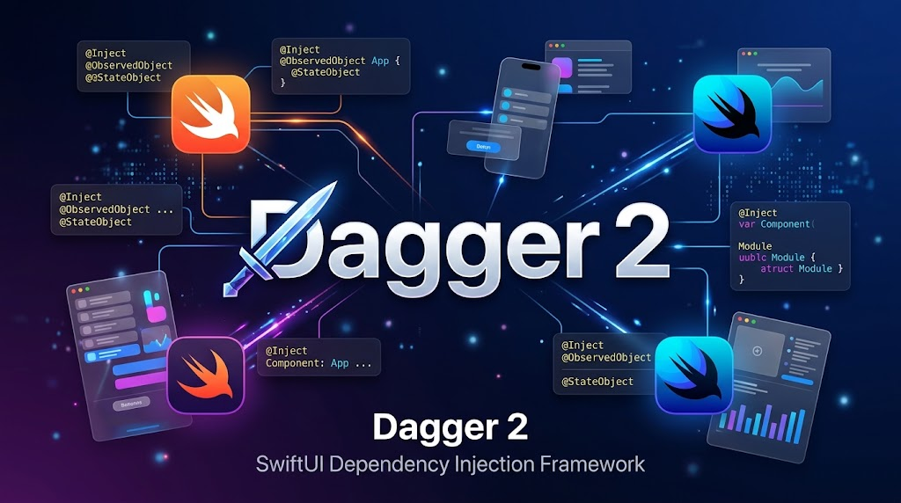
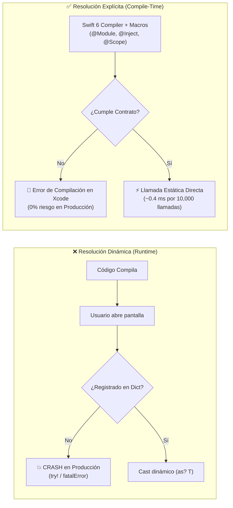
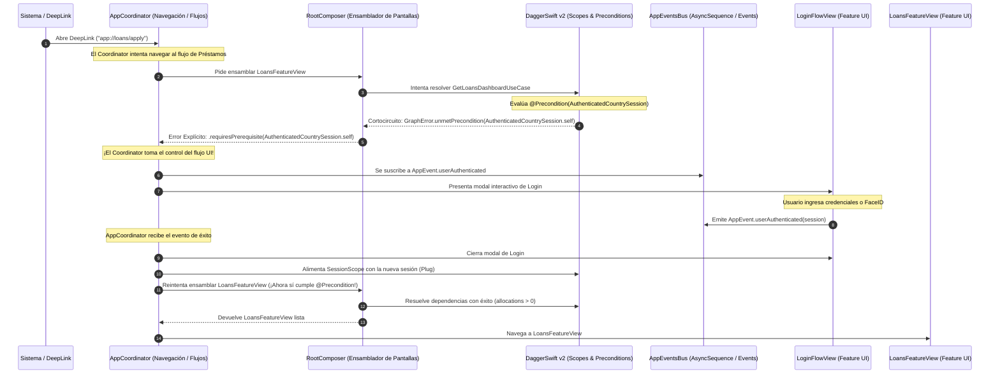
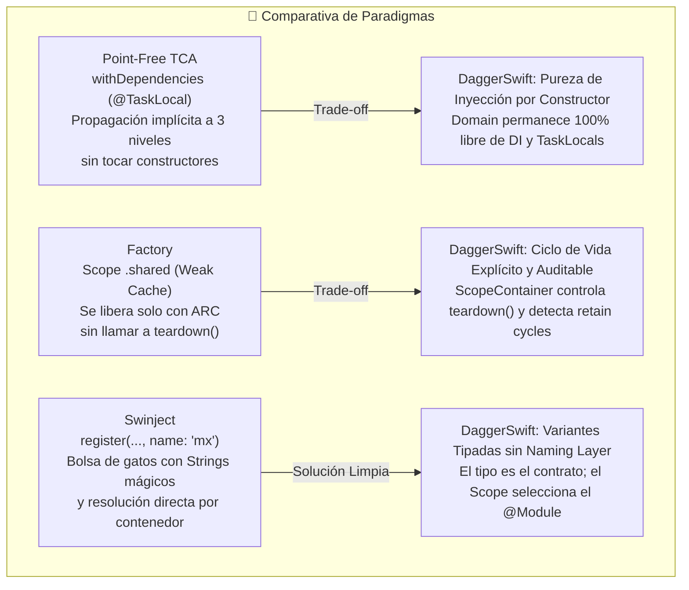
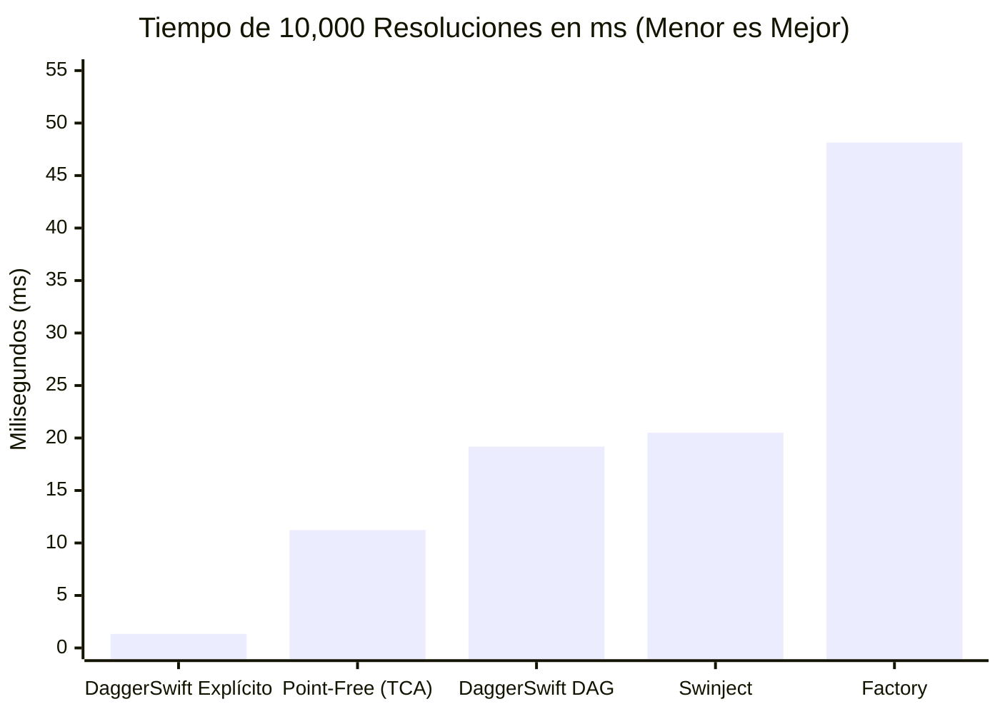
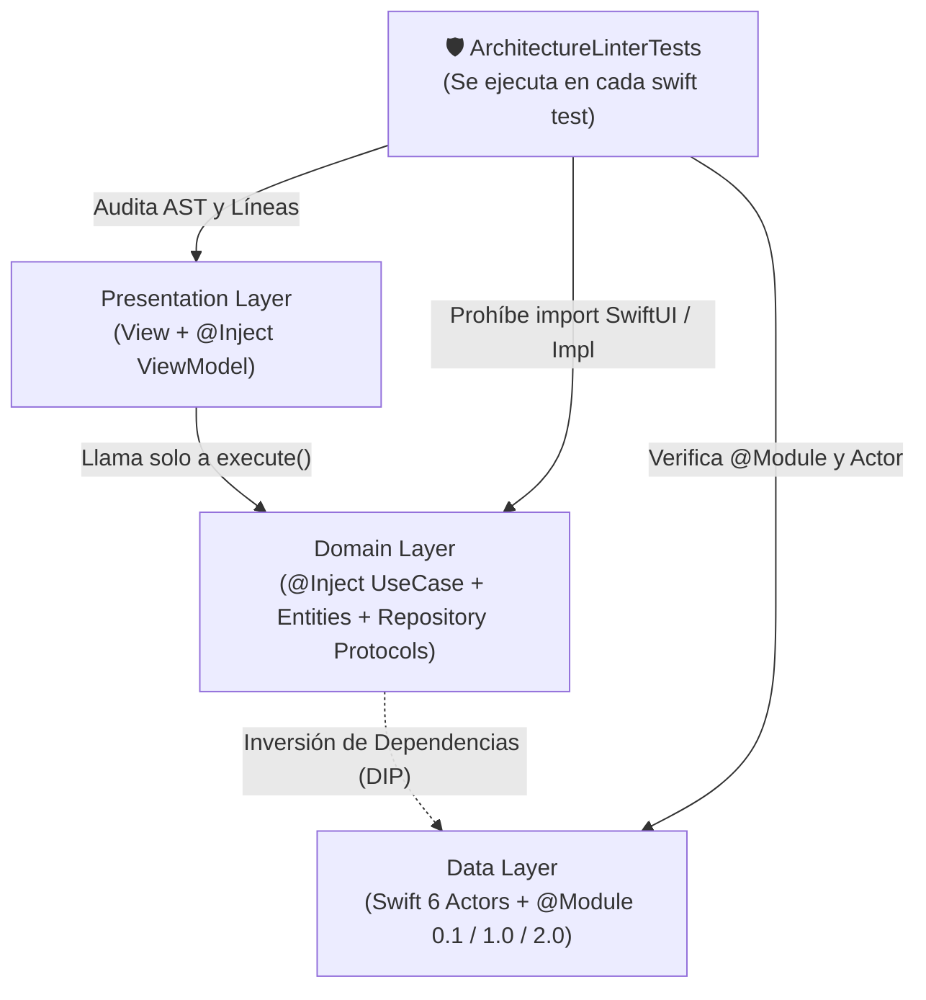

# 📘 El Libro de DaggerSwift v2: Resolución Explícita vs. Dinámica, Arquitectura de Grafos y Benchmarks



> **Autor:** Fernando Saldivar (`@fsaldivar-dev`)  
> **Versión:** DaggerSwift 2.0 · Swift 6 Strict Concurrency  
> **Suite de Validación Empírica:** [`Benchmarks/Tests/DIFrameworksDebateTests/DIFrameworksDebateTests.swift`](./Benchmarks/Tests/DIFrameworksDebateTests/DIFrameworksDebateTests.swift) (`swift test --package-path Benchmarks`) y [`Sources/SampleProyect/Tests/AppGraphTests/ArchitectureLinterTests.swift`](./Sources/SampleProyect/Tests/AppGraphTests/ArchitectureLinterTests.swift)

---

## Índice General

1. **[Capítulo 1: El Dilema Fundamental — Resolución Dinámica vs. Resolución Explícita](#capítulo-1-el-dilema-fundamental--resolución-dinámica-vs-resolución-explícita)**
2. **[Capítulo 2: Qué Hacemos en DaggerSwift v2 (Arquitectura Híbrida de Doble Motor)](#capítulo-2-qué-hacemos-en-daggerswift-v2-arquitectura-híbrida-de-doble-motor)**
3. **[Capítulo 3: Anatomía de la Competencia y los 5 Huecos que Dejan Abiertos](#capítulo-3-anatomía-de-la-competencia-y-los-5-huecos-que-dejan-abiertos)**
4. **[Capítulo 4: Benchmarks Empíricos y Pruebas de Estrés (10,000 Iteraciones)](#capítulo-4-benchmarks-empíricos-y-pruebas-de-estrés-10000-iteraciones)**
5. **[Capítulo 5: Puntos Fuertes y Puntos Débiles (Honestidad Técnica)](#capítulo-5-puntos-fuertes-y-puntos-débiles-honestidad-técnica)**
6. **[Capítulo 6: Clean Architecture, SOLID, Plug & UnPlug y Linter Automático](#capítulo-6-clean-architecture-solid-plug--unplug-y-linter-automático)**

---

## Capítulo 1: El Dilema Fundamental — Resolución Dinámica vs. Resolución Explícita

En el ecosistema iOS / macOS existen dos escuelas radicalmente distintas para construir y entregar dependencias:

### 1.1 Resolución Dinámica (En Tiempo de Ejecución / *Service Locator*)

Es el modelo popularizado por librerías como **Swinject**, **Resolver** o contenedores basados en diccionarios `[Key: Any]`.

```swift
// ❌ Modelo Dinámico: el compilador NO sabe si esto existe
let viewModel = container.resolve(FeedViewModel.self)! // o try! / try?
```

#### Cómo funciona por dentro:
1. Al arrancar la app, registras closures dentro de un diccionario global indexado por `String(reflecting: Type.self)` u `ObjectIdentifier`.
2. Cuando una vista necesita un `ViewModel`, busca la llave en el diccionario en tiempo de ejecución, hace un *downcast* (`as? T`) y devuelve `T?`.
3. Para no propagar `Optional` por toda la interfaz, los equipos terminan escribiendo `resolve()!`, `try!` o envolviendo todo en `@Injected var repo: Repo` (que por dentro hace `fatalError` si olvidaste registrar el tipo).

#### El costo oculto:
- **Cero garantía de compilación:** Si un desarrollador cambia la firma de un `UseCase` o crea un nuevo target y olvida registrar un servicio, **el proyecto compila con 0 errores**, sube a TestFlight y explota cuando el usuario entra a esa pantalla.
- **Costo en CPU y Locks:** Cada resolución implica adquirir un lock (`NSLock`), calcular el nombre del tipo o su hash, buscar en una tabla hash en el heap y hacer *type-casting* dinámico.

---

### 1.2 Resolución Explícita (En Tiempo de Compilación / *Static Dispatch*)

Es el modelo donde **el compilador de Swift verifica cada eslabón de la cadena antes de generar el binario**:

```swift
// ✅ Modelo Explícito en DaggerSwift v2:
// Si falta cualquier dependencia en el contrato del módulo, NO COMPILA.
let useCase = activeModule.makeNewsUseCase(session: session)
```

#### Cómo funciona por dentro:
1. Los módulos conforman contratos estáticos verificados por el compilador (`CountryNewsModuleContract`, `FintechModuleContract`, `GitHubServiceModuleContract`).
2. El macro `@Inject` genera en tiempo de compilación el inicializador explícito `public init(...)` de cada `UseCase` y `ViewModel`.
3. El macro `@Scope` sintetiza la paleta de versiones (`ModulePalette`: `0.1`, `1.0`, `2.0`, estilo `CodingKeys`) sin diccionarios dinámicos.
4. **Cero `try!`, cero `try?`, cero `as? T` en la app.**



---

## Capítulo 2: Qué Hacemos en DaggerSwift v2 (Arquitectura Híbrida de Doble Motor)

La mayoría de las librerías te obligan a elegir entre **seguridad estática sin herramientas de grafo** (Pure DI manual) o **un contenedor dinámico peligroso** (Swinject).

**DaggerSwift v2 une ambos mundos** mediante un **Compiler Plugin nativo en Swift 6** (que habla directamente el protocolo binario `HostToPluginMessage` del compilador, sin depender de `swift-syntax`, compilando en `< 0.3s`):

### 2.1 Los 5 Decoradores Declarativos

| Decorador | Nivel | Qué genera y qué problema resuelve |
| :--- | :--- | :--- |
| **`@Module(0.1 / 1.0 / 2.0)`** | Capa `Data / DI` | Convierte un `enum`/`struct` en un `GraphModule` y `GraphScope` con versión en la paleta. Soporta herencia modular con `includes: [ModuleV1.self]`. |
| **`@Scope(of:v0_1:v1_0:v2_0:)`** | Capa `Domain / DI` | Sintetiza automáticamente `Palette` (`ModulePalette`) y el selector estático `module(for:)` en tiempo de compilación (al estilo `CodingKeys`). |
| **`@Inject` / `@Inject(scope:)`** | Capa `Domain / Presentation` | Genera el `public init(...)` puro para resolución explícita y Unit Tests, más el auto-registro Just-In-Time para auditorías del grafo. |
| **`@BusinessRule`** | Reglas A/B y Feature Flags | Nodo de decisión que conmuta en vivo entre variantes de producto (ej. `WealthBentoLayoutVariant` vs `ClassicBalanceLayoutVariant`). |
| **`@Precondition("...")`** | Seguridad de Estado / Sesión | Cortocircuita el sub-grafo **antes** de instanciar cualquier dependencia hija si una condición de negocio (como `AuthenticatedCountrySession`) no se cumple. |

### 2.2 Evolución de Producto (`0.1 -> 1.0 -> 2.0`) y Variantes Hermanas (`MX / US / BR / FR`)

En aplicaciones reales, un módulo cambia en dos ejes:
1. **Eje Vertical (Evolución en el tiempo):** Lanzamos un MVP en `@Module(0.1)`, evolucionamos la tarjeta en `@Module(1.0, includes: [FintechModuleV0_1.self])` reutilizando el Core Bancario sin duplicar código, y lanzamos Metal en `@Module(2.0, includes: [FintechModuleV1.self])`.
2. **Eje Horizontal (Variantes hermanas / Multi-Country):** `MexicoNewsModule`, `USANewsModule`, `BrazilNewsModule` y `FranceNewsModule` comparten el mismo `CountryNewsScope` y contrato `CountryNewsModuleContract`, pero cada uno protege su propio país con su `@Precondition` local.

### 2.3 Límites de la Librería: Solo una Pieza del Rompecabezas (DI vs. App Lifecycle vs. Coordinator)

Un error muy extendido en el ecosistema de desarrollo móvil es asumir que una librería de inyección de dependencias debe solucionar **toda la arquitectura de la app**. Para mantener Clean Architecture estricta y alta cohesión, `DaggerSwift v2` asume con honestidad sus fronteras: **solo resuelve una pieza del rompecabezas**.

```text
┌────────────────────────────────────────────────────────────────────────────────────────┐
│                   🧩 EL ROMPECABEZAS DE UNA APLICACIÓN ENTERPRISE                      │
├────────────────────────────┬───────────────────────────────────────────────────────────┤
│ 1. DaggerSwift v2 (DI)     │ ✅ Memoria, Grafos, Scopes (@Scoped), Contratos y @Preconditions │
│ 2. RootComposer (Factory)  │ 🏭 Ensamblaje de Vistas + ViewModels sin Singletons               │
│ 3. AppCoordinator (Flows)  │ 🧭 Máquina de Estados de Navegación, Modales y Deep Links         │
│ 4. AppEventsBus (Reactive) │ 📡 AsyncStreams y Eventos Desacoplados (Login, Logout, Sync)      │
└────────────────────────────┴───────────────────────────────────────────────────────────┘
```

#### Los 4 Fallos Comunes en la Industria (Que ocurren si no separas estas capas)

1. **💥 El Crash del Deep Link Huérfano:** Un enlace externo abre directamente una pantalla privada (`app://loans/apply`). El `ViewModel` o `UseCase` asume que `session!` existe y crashea si el usuario estaba deslogueado. `@Precondition` bloquea la resolución en frío con `GraphError.unmetPrecondition` y 0 asignaciones en RAM.
2. **🐘 El Monolito del Inyector Todopoderoso:** Forzar al inyector a guardar routers o el `UINavigationController`, acoplando la UI al motor de dependencias.
3. **🍝 Acoplamiento Espagueti entre Pantallas:** Que la pantalla de Login tenga un switch gigante para saber a dónde redirigir al usuario según de qué pantalla vino. En nuestra arquitectura, Login solo emite `AppEvent.userAuthenticated` a través del bus reactivo.
4. **🧟 Fuga de Estado Zombie al hacer Logout (*Captive Session Bug*):** No desmontar las pantallas viejas ni limpiar diccionarios estáticos al cerrar sesión, dejando datos privados del usuario anterior visibles al siguiente login. `DaggerSwift` lo resuelve con `teardownScope()` y auditoría de cajas débiles.

#### El Flujo Canónico Completo (Diagrama de Secuencia)



---

## Capítulo 3: Debate Cara a Cara contra las Librerías Reales (`Point-Free TCA`, `Factory`, `Swinject`)

En lugar de comparar con simulaciones, creamos un paquete SPM independiente ([`Benchmarks/Package.swift`](./Benchmarks/Package.swift)) que descarga e importa las librerías reales:
- **`pointfreeco/swift-dependencies`** (usada en **TCA / The Composable Architecture**)
- **`hmlongco/Factory`** (Michael Long)
- **`Swinject/Swinject`**
- **`DaggerSwift`**

En [`DIFrameworksDebateTests.swift`](./Benchmarks/Tests/DIFrameworksDebateTests/DIFrameworksDebateTests.swift) ejecutamos dos rondas de pruebas de fallo cruzado:
- **Round 1:** Obligamos a fallar a `Point-Free TCA`, `Factory` y `Swinject` en los escenarios donde el diseño de `DaggerSwift` gana.
- **Round 2:** Obligamos a fallar a `DaggerSwift` en los escenarios donde el diseño de `Point-Free TCA`, `Factory` o `Swinject` nos gana.

### Matriz Comparativa de Capacidades

| Capacidad Arquitectónica | Swinject | Factory | Point-Free `swift-dependencies` (TCA) | **DaggerSwift v2** |
| :--- | :---: | :---: | :---: | :---: |
| **Verificación en Tiempo de Compilación** | ❌ No (`nil` en Runtime) | ⚠️ Parcial | ⚠️ Falla en Runtime si falta `testValue` | **✅ Sí (`@Module` Contracts + `@Scope`)** |
| **Cero contaminación en `Domain` (`init` puro)** | ❌ `resolver.resolve` | ❌ `@Injected` | ❌ `@Dependency` dentro de `Domain` | **✅ Sí (`@Inject` genera `init` limpio)** |
| **Variantes de Producto (Multi-Country/Versiones) sin Naming Layers** | ❌ No (Parche con `name:` String) | ❌ No (Muta contenedor global) | ⚠️ Solo en Tests (`withDependencies`) | **✅ Sí (Nativo con `@Module` + `@Scope`)** |
| **Nodos `@Precondition` (Cortocircuito de Sesión)** | ❌ No existe | ❌ No existe | ❌ No existe | **✅ Sí (`@Precondition` nativo, 0 allocs)** |
| **Nodos `@BusinessRule` (A/B Flags en el Grafo)** | ❌ Manual | ❌ Manual | ❌ Manual | **✅ Sí (`@BusinessRule` auditable)** |
| **Herencia de Evolución `@Module(0.1 -> 1.0 -> 2.0)`** | ❌ No existe | ❌ No existe | ❌ No existe | **✅ Sí (`@Scope` + `includes:`)** |
| **`teardown()` Jerárquico + Auditoría de Retain Cycles** | ❌ No audita leaks | ❌ No audita leaks | ❌ No audita leaks | **✅ Sí (`WeakObjectBox` devuelve fugas)** |
| **Weak Cache `.shared` automático sin `teardown()`** | ❌ No | **✅ Sí (`.shared`)** | ❌ No | ❌ `@Scoped` exige llamar a `teardown()` |
| **Override `@TaskLocal` profundo sin tocar `init`** | ❌ No | ❌ No | **✅ Sí (`withDependencies`)** | ❌ Exige constructor o `ScopeContainer` |

---

### Round 1: Obligando a Fallar a las Otras Librerías (Donde Gana `DaggerSwift`)

1. **`Round 1.1` — `Swinject` falla en Runtime al olvidar un registro (`testSwinjectFailsAtRuntimeOnMissingRegistration`):**
   - Si registras `BenchUseCase` en `Swinject.Container()` pero olvidas registrar `BenchRepositoryProtocol`, **el proyecto compila con 0 errores** y `swinject.resolve((any BenchRepositoryProtocol).self)` devuelve `nil` en producción.
   - En `DaggerSwift`, `BenchModuleContract` + `@Module` detiene la compilación en Xcode si falta cualquier dependencia.
2. **`Round 1.2` — `Point-Free swift-dependencies` (TCA) falla en Runtime cuando olvidas `withDependencies` (`testPointFreeDependenciesFailsWhenUnconfiguredInTest`):**
   - Cuando un `UseCase` usa `@Dependency(\.unconfiguredRepo)` y alguien lo ejecuta sin envolverlo en `withDependencies { ... }`, el código compila sin problemas pero **dispara un Issue/Fallo en Runtime** (`withKnownIssue`). Además, obliga a que tu capa `Domain` haga `import Dependencies`.
   - En `DaggerSwift`, `@Inject` sintetiza un `public init(repository:)` puro sin acoplar `Domain` a ningún framework.
3. **`Round 1.3` — `Factory` contamina el estado global cuando olvidas `.reset()` (`testFactoryGlobalStatePollutionWhenResetIsForgotten`):**
   - Si la Pantalla A o el Test A hace `Container.shared.benchRepo.register { ... }` y olvida llamar a `Container.shared.manager.reset()`, la Pantalla B recibe el Mock contaminado (`420` en lugar de `42`).
   - En `DaggerSwift`, cada `ScopeContainer` y cada variante `@Module` es independiente.
4. **`Round 1.4` — Las 3 librerías desperdician memoria instanciando objetos antes de validar la sesión (`testAllThreeLibrariesAllocateDependenciesBeforeCheckingPreconditions`):**
   - En `Swinject`, `Factory` y `Point-Free TCA`, aunque `sessionIsNil == true`, las tres alojan `BenchRepositoryImpl` en RAM (`allocations == 1`) antes de que el consumidor pueda verificar la sesión.
   - En `DaggerSwift`, `@Precondition` hace cortocircuito en la raíz del sub-grafo y `daggerRepoAllocations` permanece en **`0`**.
5. **`Round 1.5` — Ninguna de las 3 detecta un Retain Cycle al cerrar una pantalla (`testMemoryLeakDetectionOnFeatureTeardown`):**
   - Creamos `LeakyFeatureViewModel` con `self.selfRetainCycle = { _ = self }`. Ni `Swinject`, ni `Factory`, ni `Point-Free TCA` tienen auditoría de memoria al cerrar una pantalla.
   - En `DaggerSwift`, `featureScope.teardown()` devuelve `["LeakyFeatureViewModel"]` gracias a `WeakObjectBox`.
6. **`Round 1.6` — Bloqueo de *Captive Dependencies* (`testCaptiveDependencyScopeHierarchyViolation`):**
   - Si intentas resolver un componente `@Scoped` de `BenchFeatureScope` directamente desde el `root` (`GlobalScope`) sin abrir `makeChildScope(for: BenchFeatureScope.self)`, `DaggerSwift` lanza `GraphError.scopeViolation`.

---

### Round 2: Comparativa de Paradigmas y el Dilema de `TypeKey` vs. `named: String`

Un análisis técnico riguroso debe explicar por qué existen ciertas diferencias de API:



#### ¿Por qué no usamos `name: String` ni "Naming Layers" en DaggerSwift?
En `Swinject`, cuando necesitan dos implementaciones del mismo protocolo (ej. México y USA), recurren a cadenas de texto (`name: "mexico"`). Esto introduce tres problemas severos de arquitectura:
1. **Riesgo de Typos en Runtime:** Un error de dedo como `name: "mejico"` compila limpio y crashea la app en producción.
2. **Contaminación de Service Locator:** Para obtener la variante, obligas al código a invocar directamente al contenedor (`container.resolve(..., name: "mexico")`).
3. **Capa Artificial Innecesaria ("Naming Layer"):** Inventan un nombre arbitrario para parchar la falta de soporte modular de primer nivel.

#### Cómo resuelve `DaggerSwift` las Variantes sin Naming Layers (Clean Architecture):
En `DaggerSwift`, indexamos estrictamente por tipo (`TypeKey` / `ObjectIdentifier(T.self)`) para garantizar **seguridad en tiempo de compilación y despacho estático ultra-rápido**. Para tener múltiples variantes del mismo protocolo, el diseño ofrece dos soluciones limpias:

1. **Variantes por Módulo y Scope (Recomendado para Features y Países):**
   Tanto `MexicoNewsModule` como `USANewsModule` conforman el mismo contrato `CountryNewsModuleContract`. El caso de uso en `Domain` solo pide el protocolo puro:
   ```swift
   @Inject
   public struct GetHeadlineNewsUseCase {
       public let localeProvider: any CountryLocaleProviderProtocol
       public func execute() -> String { localeProvider.regionCode }
   }
   ```
   **Cero strings mágicos.** Quien decide qué implementación entregar es el `@Scope` activo:
   ```swift
   let mxModule = CountryNewsScope.module(for: .mexico) // Entrega MexicoLocaleProvider
   let usModule = CountryNewsScope.module(for: .usa)    // Entrega USALocaleProvider
   ```

2. **Protocolos Refinados en `Domain` (Cuando ambas variantes coexisten en la misma pantalla):**
   Si una pantalla de comparación necesita ambas APIs al mismo tiempo, en `Domain` se modelan como tipos de Swift:
   ```swift
   public protocol MexicoNewsApiProtocol: NewsApiProtocol {}
   public protocol USANewsApiProtocol: NewsApiProtocol {}

   @Inject
   public struct CompareNewsUseCase {
       public let mexico: any MexicoNewsApiProtocol
       public let usa: any USANewsApiProtocol
   }
   ```
   El compilador de Swift verifica los tipos, Xcode ofrece autocompletado y **ninguna capa de la app se ensucia con cadenas de texto.**

---

## Capítulo 4: Benchmarks Empíricos y Gráfico Visual (10,000 Iteraciones Reales)

Ejecutando `swift test --package-path Benchmarks` en Apple Silicon (`arm64e-apple-macos`), medimos con `ContinuousClock` 10,000 resoluciones completas (`ApiClient -> Repository -> UseCase -> execute()`) en las 4 librerías reales:

```text
╔══════════════════════════════════════════════════════════════════════════════════════════════╗
║     🥊 DEBATE EMPÍRICO Y BENCHMARK REAL (10,000 RESOLUCIONES EN PAQUETE SPM DEDICADO)        ║
╠══════════════════════════════════════════════════════════════════════════════════════════════╣
║ TIEMPO DE EJECUCIÓN ORDENADO (Menor barra = Más rápido):                                     ║
  1. DaggerSwift Explícito (@Module/@Scope) |   1.34 ms (  1.0x) |█
  2. Point-Free swift-dependencies (TCA)    |  11.23 ms (  8.4x) |██████
  3. DaggerSwift Motor DAG (ScopeContainer) |  19.18 ms ( 14.4x) |███████████
  4. Swinject (Dynamic Dictionary)          |  20.50 ms ( 15.3x) |████████████
  5. Factory (Container.shared)             |  48.15 ms ( 36.0x) |██████████████████████████████
╚══════════════════════════════════════════════════════════════════════════════════════════════╝
```



| Posición | Librería / Modo (10,000 iteraciones) | Tiempo Total | Latencia / Resolución | Ratio vs. #1 |
| :---: | :--- | :---: | :---: | :---: |
| **🥇 1** | **DaggerSwift Modo Explícito (`@Module` + `@Scope` + `@Inject`)** | **`1.34 ms`** | **`~134 ns`** | **`1.0x` (Base)** |
| **🥈 2** | **Point-Free `swift-dependencies` (`@Dependency` + `@TaskLocal`)** | **`11.23 ms`** | **`~1.12 µs`** | `8.4x` |
| **🥉 3** | **DaggerSwift Motor DAG (`ScopeContainer` + CycleCheck + WeakBox)** | **`19.18 ms`** | **`~1.91 µs`** | `14.4x` |
| **4** | **Swinject (`Swinject.Container` con `.container` + `.transient`)** | **`20.50 ms`** | **`~2.05 µs`** | `15.3x` |
| **5** | **Factory (`Container.shared` con `.singleton` + transient)** | **`48.15 ms`** | **`~4.81 µs`** | `36.0x` |

---

## Capítulo 5: Síntesis de Puntos Fuertes y Puntos Débiles

### ✅ Cuándo elegir `DaggerSwift v2`
- Quieres **Clean Architecture estricta** donde `Domain` no importe ninguna librería de terceros ni use `@Dependency` / `@Injected`.
- Necesitas modelar **Variantes Multi-Country**, **Evolución de Producto (`0.1 -> 1.0 -> 2.0`) con herencia real (`includes:`)** y **Experimentos A/B (`@BusinessRule`)**.
- Quieres **Rendimiento Máximo**: `1.34 ms` en Modo Explícito (llamada directa optimizada por Swift 6) y `19.18 ms` en el Motor DAG (superando a Swinject y Factory aún haciendo detección de ciclos y auditoría de memoria).
- Necesitas **Cortocircuito por `@Precondition`** (no alocar pantallas privadas si no hay sesión) y **Auditoría de Memory Leaks (`teardownScope()`)** al desmontar features.

### ⚠️ Cuándo otra librería puede ajustarse mejor
- Si toda tu arquitectura ya está construida sobre **The Composable Architecture (TCA)** de Point-Free y prefieres propagar dependencias implícitamente por `@TaskLocal` (`withDependencies`), **`swift-dependencies`** es más ergonómica para ese paradigma.
- Si prefieres instanciar ViewModels directamente dentro de las vistas SwiftUI con `init()` vacío (`@Injected(\.service)`) y quieres un scope `.shared` con referencias débiles automáticas sin gestionar `teardownScope()`, **`Factory`** brilla en ese caso.
- Si necesitas un diccionario completamente dinámico en runtime donde registres múltiples instancias del mismo protocolo bajo llaves `String` (`name: "mx"`) pasando argumentos dinámicos sin tipos de precondición, **`Swinject`** ofrece esa flexibilidad dinámica.

---

## Capítulo 6: Clean Architecture, SOLID, Plug & UnPlug y Linter Automático

Para garantizar que ningún desarrollador degrade la arquitectura con el paso del tiempo, `SampleProyect` incluye un **Linter Arquitectónico Ejecutable** ([`ArchitectureLinterTests.swift`](./Sources/SampleProyect/Tests/AppGraphTests/ArchitectureLinterTests.swift)) que se corre en cada `swift test` y verifica **7 Reglas Inquebrantables**:



| Regla del Linter | Principio que Protege | Qué falla si alguien la rompe |
| :--- | :--- | :--- |
| **`[RULE-01]` División por Capas** | Clean Architecture | Exige `Domain/Entities`, `Domain/Repositories`, `Domain/UseCases`, `Data/Repositories`, `Data/DI`, `Presentation/View`, `Presentation/ViewModel` y prohíbe `*Composer.swift` manuales. |
| **`[RULE-02]` Pureza de `Domain`** | Independiente de Frameworks | Falla si cualquier archivo en `Domain/` o `Core/` importa `SwiftUI` o menciona `*Impl`, `*Actor` o `Live*`. |
| **`[RULE-03]` Encapsulamiento en `UseCase`** | SRP + Ley de Demeter | Exige `@Inject`, `func execute(...)` y prohíbe que los repositorios internos del `UseCase` sean `public let`. |
| **`[RULE-04]` UnCoupling en `Presentation`** | DIP (SOLID) | Prohíbe que `View` o `ViewModel` instancien clases de `Data` o atraviesen un `UseCase` para tocar un repositorio (`.coreBanking.`, `.gitHubRepository.`). |
| **`[RULE-05]` Plug & UnPlug Real** | OCP + LSP + Ciclo de Vida | Exige que los módulos de DI usen `@Module` y que los `ViewModels` invoquen `teardownScope()` al desconectar un módulo. |
| **`[RULE-06]` Seguridad & Concurrencia Swift 6** | Thread-Safety & Zero Force-Try | Prohíbe `try!`, `try?`, `ScopeContainer`, `NSLock` y `@unchecked Sendable` en toda la app. |
| **`[RULE-07]` Simplicidad (KISS)** | Legibilidad en 30 segundos | Ningún archivo de ejemplo en `Sources/SampleProyect/Sources/` puede superar las **180 líneas**. |
