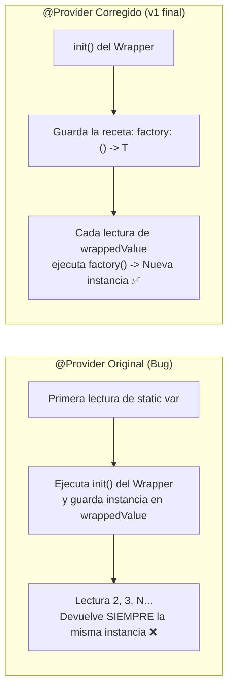
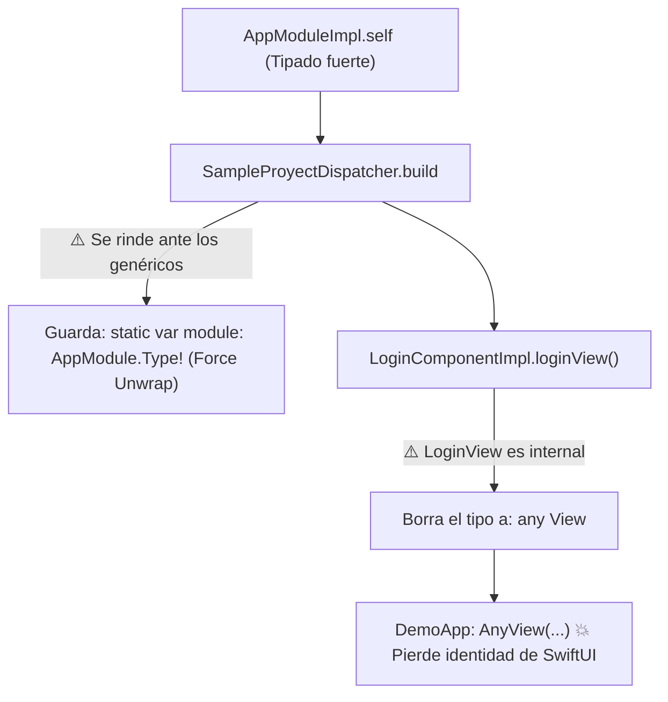
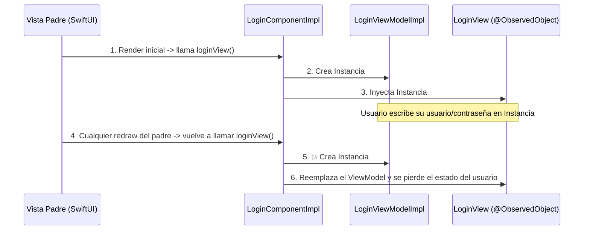
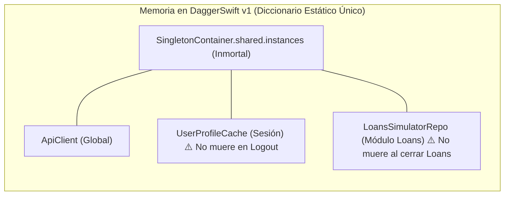
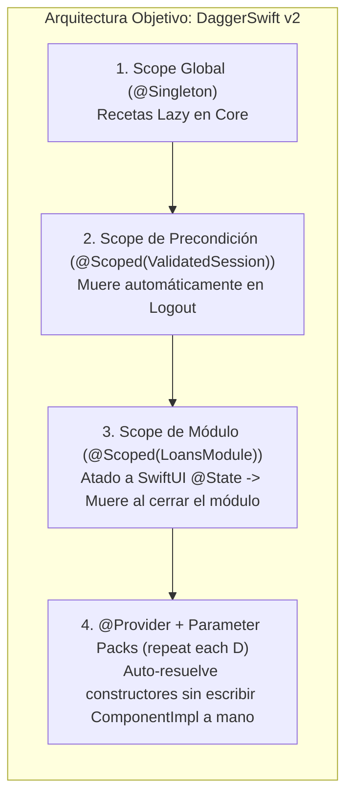

# Memoria Técnica: DaggerSwift v1
## Limitaciones, Bugs Resueltos y Dolores de Cabeza en Apps Productivas

> *"El conocimiento se pudre cuando se guarda. Se mantiene vivo cuando se comparte."*

Este documento registra el cierre técnico del experimento **DaggerSwift v1** (octubre 2024 – octubre 2026): qué demostró con éxito, qué errores técnicos quedaron ocultos en su primera implementación y, sobre todo, **por qué llevar este patrón directo de UIKit a producción con SwiftUI genera dolores de cabeza que obligan a evolucionar hacia DaggerSwift v2**.

---

## 1. Lo que DaggerSwift v1 logró demostrar (El ADN que se conserva)

Antes de hablar de las limitaciones, vale dejar registro de lo que la v1 resolvió correctamente sin depender de herramientas externas:

1. **Validación en tiempo de compilación (`Modulable` + `Component`)**:
   A diferencia de contenedores en runtime como *Swinject* o *Resolver*, si una dependencia faltaba en `AppModuleImpl` o en `AppModuleFaker`, el proyecto simplemente **no compilaba**.
2. **Módulos como "Cajas Negras" (`SampleProyect`)**:
   Todas las vistas (`LoginView`), ViewModels (`LoginViewModelImpl`), casos de uso (`LoginUseCaseImpl`) y componentes (`LoginComponentImpl`) pudieron declararse como `internal` dentro del paquete de la feature, exponiendo únicamente el contrato de entrada y las dependencias requeridas.
3. **Targets independientes de Producción vs. Faker (`Demo` y `DemoFaker`)**:
   Permitió levantar una micro-app conectada a servicios reales (`Demo`) y otra conectada 100% a mocks (`DemoFaker`) cambiando únicamente el tipo estático pasado al construir el módulo.
4. **Constructores limpios en las capas internas**:
   Las clases de dominio y datos (`LoginUseCaseImpl`, `AppRepositoryImpl`) recibían sus dependencias por `init`, sin contaminar la lógica de negocio con `@propertyWrapper`s que estorbaran en las pruebas unitarias.

---

## 2. Lo que nos faltó en Dagger 1 (y cómo se cerró hoy)

Al retomar el repositorio bajo **Swift 6.4**, encontramos 4 problemas técnicos que habían dejado inconclusa la v1:

### 2.1. El bug silencioso de `@Provider`: era un Singleton disfrazado
En la versión original de [`Sources/DaggerSwift/Module.swift`](Sources/DaggerSwift/Module.swift):
```swift
@propertyWrapper
public struct Provider<T> {
    public var wrappedValue: T

    public init(_ wrappedValue: @autoclosure @escaping () -> T) {
        self.wrappedValue = wrappedValue() // ❌ Se ejecutaba UNA sola vez
    }
}
```
Como `@Provider` se aplicaba a propiedades `static var`, Swift inicializaba el wrapper una única vez, ejecutaba `wrappedValue()` en el `init` y guardaba el resultado en la variable almacenada `wrappedValue`. **Todas las lecturas posteriores devolvían exactamente la misma instancia**.
- **Corrección aplicada en v1**: `Provider` ahora almacena el closure `private let factory: @MainActor () -> T` y lo ejecuta en cada lectura del getter computado `public var wrappedValue: T { factory() }`.



### 2.2. El choque frontal de `@propertyWrapper` + `static var` con Swift 6
En Swift, un `@propertyWrapper` no puede aplicarse a un `static let`; exige obligatoriamente `static var`. Al compilar en modo estricto de **Swift 6**, el compilador sintetiza una variable global mutable (`static var _propiedad`) y aborta con:
> `error: static property '...' is not concurrency-safe because it is nonisolated global shared mutable state [#MutableGlobalVariable]`

Esa fue la razón por la que en 2024 el target `DemoFaker` tuvo que bajarse a Swift 5.0 mientras `Demo` en Swift 6.0 intentaba usar `actor AppModuleImpl` sin lograr compilar.
- **Corrección aplicada en v1**: Se aislaron `Modulable`, `Component`, `@Singleton`, `@Provider` y `SingletonContainer` en `@MainActor`, permitiendo que tanto `swift test` como `Demo` y `DemoFaker` compilen limpiamente en **Swift 6.0**.

### 2.3. Evaluación ansiosa (Eager) en `@Singleton`
Originalmente `@Singleton` llamaba a `SingletonContainerActor.resolve` dentro de su `init`, en lugar de hacerlo de forma perezosa cuando alguien leyera `wrappedValue`, y no aceptaba la firma estándar `init(wrappedValue:)`.
- **Corrección aplicada en v1**: Se movió la resolución al getter de `wrappedValue` usando `String(reflecting: T.self)` y soportando tanto `@Singleton(Valor())` como `@Singleton(wrappedValue: Valor())`.

### 2.4. Acoplamiento innecesario con `UIKit` y rutas rotas
- `Sources/DaggerSwift/Module.swift` importaba `UIKit` sin usarlo, impidiendo compilar y correr `swift test` en macOS.
- `Demo.xcodeproj` apuntaba a una ruta relativa inexistente (`../../../Dagger-swift` en vez de `../..`).
- `SampleProyectDispatcher` tenía `fatalError("")` en la ruta `.error` pese a que `ErrorView` ya existía en `CommonError.swift`.

---

## 3. Dolores de Cabeza en Apps Productivas (Por qué la v1 no escala)

Al llevar el diseño de **DaggerSwift v1** a escenarios reales de producción y a **SwiftUI**, aparecen **6 dolores arquitectónicos graves** que demuestran que no hay balas de plata:

### Dolor 1: Hacer a mano el trabajo del compilador (Burocracia y Boilerplate)
En Android, nadie escribe los `Component` ni el cableado `Module.provideUserRepository(apiService: Module.apiService)` a mano; eso lo escribe el generador de código de Dagger.
En **DaggerSwift v1**, el humano carga con toda esa burocracia:
- Para agregar una dependencia hay que modificar hasta **6 lugares** (`Protocolo de Servicio`, `Impl`, `Protocolo Module`, `Module Real`, `Module Faker`, `ComponentImpl`).
- Cuando un constructor crece a 10 o 15 dependencias entre globales y locales, el archivo `ComponentImpl` se vuelve inmanejable y el equipo termina odiando el framework.

### Dolor 2: La "Infección de Genéricos" (`<T: AppModule>`) y la rendición ante `AnyView`
Propagar el módulo como un genérico estático (`LoginComponentImpl<Module: AppModule>`) funciona en niveles bajos, pero los genéricos en Swift son contagiosos: todo lo que llame al componente tiene que volverse genérico.
Cuando llegas a la frontera pública del módulo (`SampleProyectDispatcher`), el sistema de tipos te acorrala y te obliga a rendirte haciendo dos cosas que destruyen la promesa del framework:
1. Guardar el módulo en una variable global con *force unwrap*: `static var module: AppModule.Type!`.
2. Borrar el tipo de retorno a `any View` y envolverlo en `AnyView(...)`, lo cual **destruye la identidad estructural del árbol de SwiftUI** (rompiendo animaciones, transiciones y diffing).



### Dolor 3: Recreación de `ViewModels` y pérdida de estado en SwiftUI
En [`LoginComponent.swift`](Sources/SampleProyect/Sources/SampleProyect/Presentation/Login/LoginComponent.swift) y [`LoginView.swift`](Sources/SampleProyect/Sources/SampleProyect/Presentation/Login/LoginView.swift):
```swift
let model = LoginViewModelImpl(loginUseCase: loginUseCase)
let view = LoginView<LoginViewModelImpl>.init(model: model) // @ObservedObject var presenter: T
```
En **UIKit**, el Coordinator instanciaba el `UIViewController` una sola vez al hacer `pushViewController`.
En **SwiftUI**, las vistas son `struct` efímeras: cada vez que la vista padre se redibuja, vuelve a ejecutar `loginView()`, **creando un `LoginViewModelImpl` nuevo desde cero** y perdiendo todo el estado en pantalla porque `@ObservedObject` no es dueño del ciclo de vida del objeto.



### Dolor 4: El "App Launcher" obeso (Falta de resolución topológica en el grafo)
DaggerSwift v1 no tiene un motor de grafo real que sepa qué nodo depende de qué otro nodo para inicializarlos bajo demanda. En una app productiva grande, esto lleva a que el `AppDelegate` / Launcher inicialice 40 SDKs y servicios al arrancar "por si acaso", degradando el tiempo de arranque en frío (*cold start*).

### Dolor 5: Ceguera ante Dependencias de Negocio (Feature Flags) y Precondiciones (Sesión / Deep Links)
En una aplicación real no todas las dependencias son objetos técnicos de **Dominio** (`ApiClient`, `Repository`):
1. **Dependencias de Negocio (Feature Flags)**: Imponen el comportamiento del flujo (por ejemplo, decidir en el grafo si debemos cablear hacia el sistema viejo `A` o hacia el sistema nuevo `B` durante una migración progresiva).
2. **Precondiciones de Estado (ej. `Sesión Validada`)**: Si el usuario abre la app cerrada desde un **Deep Link** hacia un módulo interno, **no se puede instanciar el componente si nadie ha validado la sesión primero**. Dagger 1 asume que toda dependencia se puede instanciar síncronamente con `.init()`, sin forma de expresar en el grafo que falta satisfacer la precondición de `Sesión`.

### Dolor 6: Fugas de memoria por falta de Scopes Jerárquicos (Todo es inmortal o efímero)
En Dagger 1 solo existen dos extremos:
- `@Provider`: Crea una instancia nueva cada vez (no permite compartir estado entre las 3 pantallas internas de un módulo como `Loans`).
- `@Singleton`: Guarda la instancia en un diccionario estático global **para toda la vida de la app**.

**Consecuencias en producción:**
1. Si guardas datos en `@Singleton` para compartirlos dentro del módulo `Loans`, **cuando el usuario cierra `Loans` la memoria jamás se libera**.
2. Si el usuario cierra sesión (Logout) e inicia con otra cuenta, los `@Singleton` conservan en RAM la información del usuario anterior.
3. Si dos módulos registran un `@Singleton` con el mismo protocolo (`any ApiClient`), colisionan en el diccionario global `SingletonContainer` porque comparten la misma llave `String(reflecting: T.self)`.



---

## 4. Conclusión: Qué debe resolver DaggerSwift v2

Para que `DaggerSwift` sea una herramienta real en **SwiftUI + Swift 6** y no un dolor de cabeza burocrático, la **v2** debe cambiar estas reglas de raíz:



1. **Auto-resolución del Grafo (Adiós a escribir `ComponentImpl` a mano)**: Usar el sistema de tipos de Swift 6 (*Parameter Packs* `repeat each Dependency`) para que cada nodo deduzca y resuelva sus dependencias en cascada sin cableado manual.
2. **Árbol de Scopes con muerte automática en RAM (`Global` $\rightarrow$ `Session` $\rightarrow$ `Module`)**: Que al cerrar el módulo `Loans` en SwiftUI (o al invalidar la `Sesión`), su contenedor local se destruya automáticamente liberando todas sus dependencias, auditado con un detector de *memory leaks* (`WeakBox`) en `DEBUG`.
3. **Tres tipos de Nodos en el Grafo**:
   - **Dominio** (`@Singleton`, `@Scoped`, `@Provider`)
   - **Negocio** (`@BusinessRule` / Feature Flags para migraciones progresivas `A -> B`)
   - **Precondición** (`@Precondition`, ej. `ValidatedSession`, que impide construir un componente en un Deep Link si el requisito previo no está satisfecho).
4. **Cero contaminación en Unit Tests**: Que las clases de dominio y presentación (`UseCase`, `Repository`, `ViewModel`) no tengan decoradores internos y se prueben con su `init` puro.
