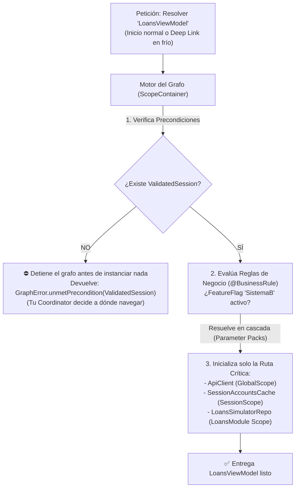
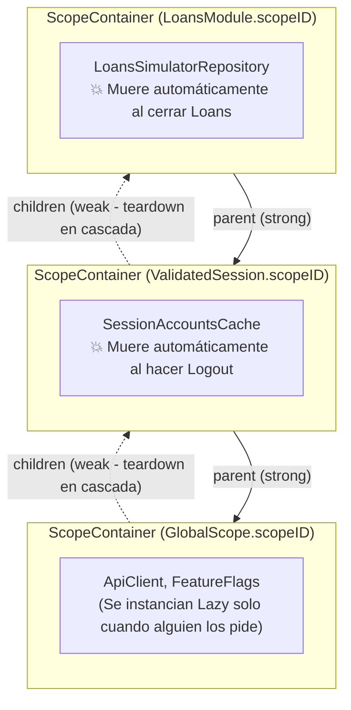

# dagger-swift

Motor de resolución de **Grafo de Dependencias (DAG)** y **Scopes Jerárquicos** para Swift 6 y SwiftUI.

Inspirado en [Dagger (Android)](https://dagger.dev), evolucionado en **v2** para resolver no solo dependencias técnicas de Dominio, sino también **Reglas de Negocio (Feature Flags para migraciones progresivas `A -> B`)**, **Precondiciones de Estado (como `Sesión Validada` en Deep Links)** y **ciclos de vida de memoria por Módulo (`Scopes`)** que mueren automáticamente al cerrar un flujo en SwiftUI.

---

## Por qué

La mayoría de las librerías de DI en Swift (*Swinject*, *Resolver*, *Factory*) tienen tres problemas en aplicaciones grandes:
1. **No entienden el grafo de arranque**: los *App Launchers* terminan inicializando 40 servicios al arrancar porque nadie sabe qué depende de qué.
2. **Todo vive en un contenedor global inmortal**: las dependencias de un módulo como `Loans` o de una `Sesión` nunca se liberan de la memoria RAM cuando el usuario sale del módulo o cierra sesión.
3. **No distinguen entre Dominio, Negocio y Precondiciones**: si entra un *Deep Link* con la app cerrada hacia un módulo que exige sesión, intentan instanciar la pantalla sin que nadie haya validado la sesión.



---

## Novedades en `DaggerSwift v2`

### 1. Auto-resolución en cascada con Swift 6 Parameter Packs (`repeat each D`)
Ya **no necesitas escribir `ComponentImpl` manuales** pasando parámetro por parámetro, ni contaminar tus clases con `@propertyWrapper`s que estorben en los Unit Tests.
Tus `ViewModel`, `UseCase` y `Repository` tienen constructores `init` 100% puros, y en el `GraphModule` solo pasas su `.init`:

```swift
// Tus clases son Swift puro (CERO decoradores adentro -> Unit Tests limpios):
final class LoansUseCase {
    let repository: any LoansSimulatorRepository
    let calculator: any LoanInterestCalculator

    init(repository: any LoansSimulatorRepository, calculator: any LoanInterestCalculator) {
        self.repository = repository
        self.calculator = calculator
    }
}

// En el módulo solo pasas LoansUseCase.init y Swift 6 deduce y resuelve todos sus parámetros:
enum LoansModule: GraphModule {
    static func register(in container: ScopeContainer) {
        container.provideScoped((any LoansSimulatorRepository).self, factory: LoansSimulatorRepositoryImpl.init)
        container.provide(LoansUseCase.init)
        container.provide(LoansViewModel.init)
    }
}
```

### 2. Árbol de Scopes con destrucción automática en RAM (`Global` $\rightarrow$ `Session` $\rightarrow$ `Module`)
Cada `GraphModule` y cada `Precondition` **genera automáticamente su propio `ScopeID`** (sin escribir `CodingKeys` ni `enum`s manuales):



- Cuando el usuario cierra el módulo `Loans`, `loansScope.teardown()` (o `GraphScopeView` en SwiftUI) vacía únicamente la caja de `Loans`, notifica `onScopeTeardown()` (`ScopeDisposable`) para cancelar `Task`s, y **audita con referencias `weak` (`WeakObjectBox`) que no hayan quedado *retain cycles* en memoria**.

### 3. Los 3 Tipos de Nodos del Grafo

| Tipo de Nodo | API en `ScopeContainer` | Qué resuelve |
| :--- | :--- | :--- |
| **1. Dominio** | `provideSingleton`, `provideScoped`, `provide` | Servicios técnicos, repositorios y ViewModels con ciclo de vida controlado (`Global`, `Session`, `Module` o `Transient`). |
| **2. Negocio** | `provideBusinessRule` | Feature Flags y reglas que bifurcan el grafo entre una implementación vieja (**Sistema A**) y una nueva (**Sistema B**) en migraciones progresivas. |
| **3. Precondición** | `providePrecondition` | Requisitos de estado (ej. `ValidatedSession`). Si no se cumplen al entrar por un Deep Link, el grafo aborta antes de crear el módulo e informa exactamente qué precondición falta. |

### 4. Soporte Universal: SwiftUI, UIKit, AppKit, Actors y CLIs
El motor [`ScopeContainer`](Sources/DaggerSwift/ScopeContainer.swift) solo depende de `Foundation` y es 100% *thread-safe* (`Sendable` mediante `NSRecursiveLock`), por lo que funciona en cualquier entorno:

#### A. En SwiftUI (`GraphScopeView`)
Monta el Scope de un módulo atado al ciclo de vida de la vista en SwiftUI sin usar `AnyView`. Cuando la vista sale de la pila de navegación, el `ScopeContainer` ejecuta `teardown()` automáticamente:

```swift
GraphScopeView(scope: LoansModule.self, parent: sessionScope) { loansContainer in
    LoansRootView(viewModel: try loansContainer.resolve(LoansViewModel.self))
} onBlocked: { graphError in
    // Tu Coordinator decide qué hacer cuando falta ValidatedSession u otra precondición
    CoordinatorRedirectView(error: graphError)
}
```

#### B. En UIKit / AppKit / Coordinators (`autoTeardown(whenDeallocated:)`)
En aplicaciones **UIKit** o híbridas (migrando de UIKit a SwiftUI), puedes atar la vida del `ScopeContainer` a cualquier `UIViewController`, `NSViewController` o `Coordinator`. Cuando el usuario hace *pop* del `UINavigationController` y ARC destruye el controlador, el Scope se limpia solo:

```swift
let loansScope = sessionScope.makeChildScope(for: LoansModule.self)
let viewController = LoansViewController(viewModel: try loansScope.resolve(LoansViewModel.self))

// Cuando 'viewController' haga deinit al salir de pantalla, 'loansScope' ejecuta teardown() solo:
loansScope.autoTeardown(whenDeallocated: viewController)
navigationController.pushViewController(viewController, animated: true)
```

#### C. En Background Actors, Extensions y CLIs
Al no depender de `@MainActor`, cualquier `actor`, `Task.detached`, *App Extension* o ejecutable de línea de comandos puede resolver su grafo desde cualquier hilo de forma segura.

---

## Swift Macros en `DaggerSwift v2` (`@Module` & `@Inject`)

Para eliminar el boilerplate y garantizar **cero acoplamiento** en tus clases de dominio, DaggerSwift v2 incluye un **Compiler Plugin nativo en Swift 6 (sin dependencias externas pesadas)**:

```swift
// 1. Declaras tu módulo con funciones estáticas y anotaciones de rol:
@Module
public enum CoreGraphModule {
    @Singleton
    static func apiClient() -> any ApiClient {
        ApiClientRealImpl()
    }

    @BusinessRule
    static func checkoutService(flags: FeatureFlagStore, api: any ApiClient) -> any CheckoutService {
        flags.useBentoV2 ? BentoCheckout(api: api) : LegacyCheckout(api: api)
    }

    @Precondition("Se requiere sesión activa")
    static func session(auth: AuthStore) -> ValidatedSession? {
        auth.currentSession
    }
}

// 2. En tus clases de negocio, usas @Inject:
//    - Genera el `init(...)` limpio para tus Unit Tests sin necesidad de grafo ni mocks raros.
//    - Auto-registra la clase Just-In-Time en el scope correspondiente.
@Inject(scope: LoansModule.self)
final class LoansRepository {
    let api: any ApiClient
    let session: ValidatedSession // <- Exige la precondición automáticamente antes de construir
}
```

---

## Herramienta CLI (`dagger-cli`)

DaggerSwift incluye un ejecutable nativo para terminal que demuestra la resolución del grafo, simulación de autenticación en frío, reglas de negocio y pruebas de estrés de memoria:

```bash
# Ver ayuda y comandos disponibles
swift run dagger-cli help

# Consultar el perfil oficial de @fsaldivar-dev desde GitHub API
swift run dagger-cli profile

# Listar repositorios destacados del autor
swift run dagger-cli repos

# Probar el bloqueo de rutas protegidas mediante @Precondition (ValidatedSession)
swift run dagger-cli test-auth

# Probar el cambio dinámico de @BusinessRule (Sistema A vs B)
swift run dagger-cli test-flag

# Ejecutar stress-test de 25 sub-scopes con auditoría WeakObjectBox (0 Leaks)
swift run dagger-cli stress-test

# Leer el Manifiesto de Aaron Swartz, Jonas Salk y Dagger 1 -> 2
swift run dagger-cli manifesto
```

---

## Retrocompatibilidad con `DaggerSwift v1`

Las primitivas originales de la v1 (`Modulable`, `Component`, `@Singleton`, `@Provider`) siguen 100% disponibles y funcionando en Swift 6 mediante macros accesoras:

```swift
protocol AppModule: Modulable {
    static var apiService: ApiService { get }
    static var analisisRepository: AnalisiRepository { get }
    static func provideUserRepository(apiService: ApiService) -> UserRepository
}

enum AppModuleImpl: AppModule {
    @Provider(wrappedValue: ApiService())
    static var apiService: ApiService

    @Singleton(wrappedValue: AnalisiRepository(apiService: apiService))
    static var analisisRepository: AnalisiRepository

    static func provideUserRepository(apiService: ApiService) -> UserRepository {
        .init(apiService: apiService)
    }
}
```

---

## Estructura del Repositorio, Clean Architecture y Linter

```text
├── Package.swift                        # Configuración SPM (Swift 6.0, macOS 14+ / iOS 17+, CLI + Macros + Testing)
├── Sources/
│   ├── DaggerSwift/
│   │   ├── GraphScope.swift             # v2: ScopeID, GraphScope, GlobalScope, Precondition, GraphError
│   │   ├── ScopeContainer.swift         # v2: Motor DAG, Árbol de Scopes, Parameter Packs y Auditor de Leaks
│   │   ├── SwiftUIGraph.swift           # v2: GraphScopeView y ciclo de vida automático en SwiftUI
│   │   └── Module.swift                 # Macros: @Module(0.1/1.0/2.0), @Scope (ModulePalette), @Inject, @Singleton, @Scoped, @Provider, @BusinessRule, @Precondition
│   ├── DaggerSwiftMacros/               # Compiler Plugin nativo Swift 6 (protocolo JSON HostToPluginMessage sin dependencias)
│   ├── DaggerSwiftTesting/              # DSL de pruebas del grafo: expectGraph, expectWhenCondition, matchesContract
│   ├── DaggerCLI/                       # Herramienta de terminal (swift run dagger-cli)
│   ├── SampleProyect/                   # Paquete SPM Modular con 3 Demos (Clean Architecture + MVVM + SOLID + Plug & UnPlug):
│   │   ├── Sources/
│   │   │   ├── AppFoundation/           # Modelos base y Design System compartido
│   │   │   ├── MultiCountryNewsDemo/    # Demo 1: Login Multi-Country + Noticias en 4 Idiomas (MX, US, BR, FR)
│   │   │   │   ├── Domain/              # Entities, Repository Protocols (CountryNewsModuleContract) y UseCases (@Inject)
│   │   │   │   ├── Data/                # Actores Swift 6 por país y @Module(1.0, scope: CountryNewsScope.self)
│   │   │   │   └── Presentation/        # MVVM: CountryNewsPortalViewModel (@Inject) + CountryNewsFeatureView
│   │   │   ├── FintechMockupDemo/       # Demo 2: App Mockup Fintech con Paleta @Module(0.1/1.0/2.0) + @Scope + A/B Flags
│   │   │   │   ├── Domain/              # Entities, Repository Protocols (FintechModuleContract) y GetFintechDashboardUseCase
│   │   │   │   ├── Data/                # FintechBankingActor y @Module(0.1), @Module(1.0), @Module(2.0) + @Scope
│   │   │   │   └── Presentation/        # MVVM: FintechMockupViewModel (@Inject) + FintechMockupFeatureView
│   │   │   ├── Core/                    # Demo 3 (Domain): Protocolos, @Precondition ValidatedSession y UseCases (@Inject)
│   │   │   ├── Services/                # Demo 3 (Data): LiveGitHubRepository + LiveGitHubModule (1.0) / LiveGitHubModuleV2 (2.0)
│   │   │   ├── Features/                # Demo 3 (Presentation): FeedViewModel (@Inject), FeedView y Sub-Scope RepoDetailModule
│   │   │   └── SampleProyect/           # ShowcaseRootView: Selector de las 3 Demos y switch Plug & UnPlug en vivo
│   │   └── Tests/
│   │       ├── AppUnitTests/            # Pruebas unitarias de UseCases y ViewModels con Fakes sin grafo
│   │       └── AppGraphTests/           # Pruebas del grafo (DaggerSwiftTesting) + ArchitectureLinterTests (Linter SOLID/Clean)
│   └── Demo/                            # Aplicación Xcode iOS / iPadOS / macOS:
│       ├── Demo/                        # Target Live
│       └── DemoFaker/                   # Target Sandbox Fintech A/B
```

---

## Ejecutar Pruebas y Linter de Arquitectura

```bash
# Ejecutar tests del motor principal DaggerSwift
swift test

# Ejecutar Linter de Arquitectura/SOLID + Unit Tests + Graph Tests del SampleProyect
swift test --package-path Sources/SampleProyect
```

---

## Documentación Adicional

- 👉 **[Memoria Técnica: Limitaciones de DaggerSwift v1 y Dolores en Apps Productivas](./MEMORIA_DAGGER_V1.md)**
- 👉 **[Manifiesto](./MANIFESTO.md)**

## Licencia

MIT

