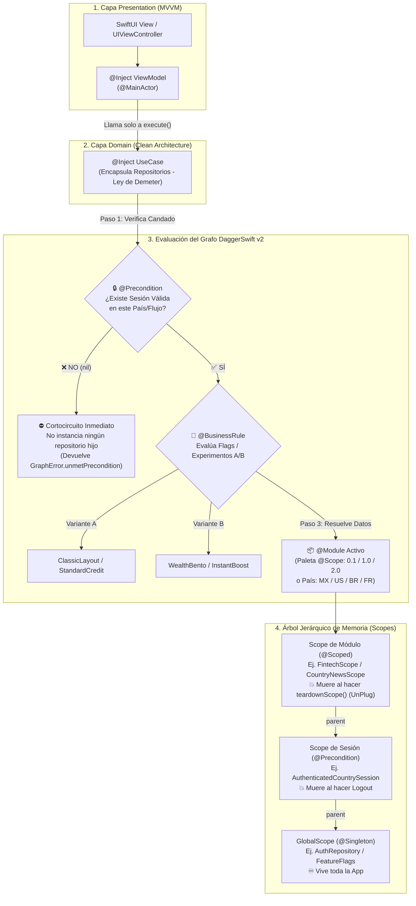
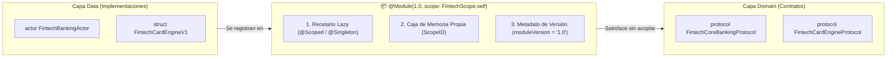
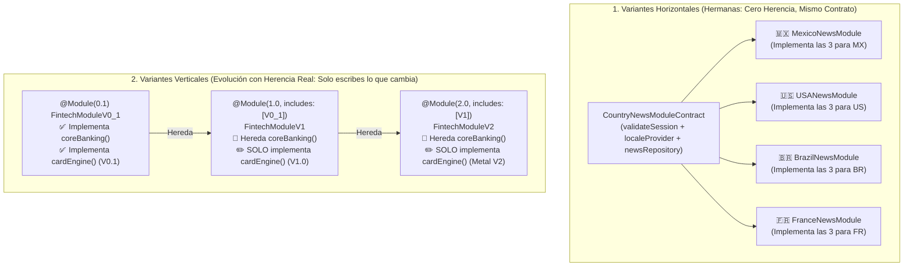
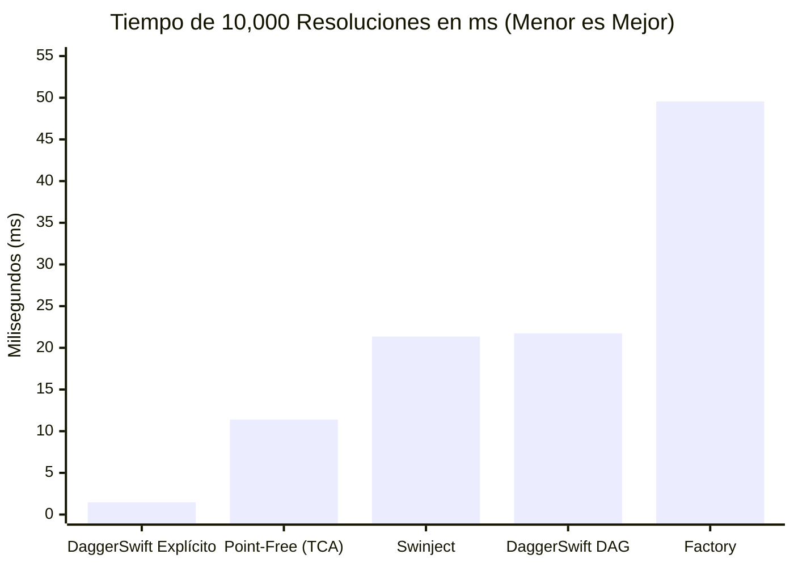

# DaggerSwift v2 (`dagger-swift`)


Motor híbrido de **Resolución Explícita en Tiempo de Compilación (`@Module`, `@Scope`, `@Inject`)** y **Grafo Jerárquico de Dependencias (`@BusinessRule`, `@Precondition`, `teardownScope()`)** para Swift 6, SwiftUI, UIKit y Actores de Concurrencia.

> 📘 **[Leer el Libro Completo: Resolución Explícita vs. Dinámica, Comparativa contra Otras Librerías y Benchmarks](./LIBRO_INYECCION_Y_BENCHMARKS.md)**

---

## 📑 Tabla de Contenidos (Manual Completo)

1. **[Cómo Funciona el Grafo de Dependencias (Diagrama General)](#1--cómo-funciona-el-grafo-de-dependencias-diagrama-general)**
2. **[Manual de Conceptos y Decoradores](#2--manual-de-conceptos-y-decoradores)**
   - [2.1 ¿Qué es un `@Module`?](#21-qué-es-un-module)
   - [2.2 ¿Qué es una Variante y cómo se modela? (3 Tipos de Variantes)](#22-qué-es-una-variante-y-cómo-se-modela-3-tipos-de-variantes)
   - [2.3 ¿Cómo funciona `@Inject` y `@Inject(scope:)` por dentro?](#23-cómo-funciona-inject-y-injectscope-por-dentro)
   - [2.4 ¿Qué es una `@Precondition` (Candado de Estado / Sesión por País)?](#24-qué-es-una-precondition-candado-de-estado--sesión-por-país)
   - [2.5 Ciclo de Vida, Memoria y `Plug & UnPlug` (`teardownScope()`)](#25-ciclo-de-vida-memoria-y-plug--unplug-teardownscope)
3. **[Manual Completo de Pruebas (`DaggerSwiftTesting` + Unit Tests + Linter)](#3--manual-completo-de-pruebas-daggerswifttesting--unit-tests--linter)**
   - [3.1 Nivel 1: Pruebas Unitarias Puras (Sin Grafo)](#31-nivel-1-pruebas-unitarias-puras-sin-grafo)
   - [3.2 Nivel 2: Pruebas del Grafo de Dependencias (`expectGraph` DSL)](#32-nivel-2-pruebas-del-grafo-de-dependencias-expectgraph-dsl)
   - [3.3 Nivel 3: Linter Automático de Arquitectura y SOLID](#33-nivel-3-linter-automático-de-arquitectura-y-solid)
4. **[Benchmarks y Comparativa contra Otras Librerías](#4--benchmarks-y-comparativa-contra-otras-librerías)**
5. **[Demos Reales Incluidas (`SampleProyect`) y Estructura del Repositorio](#5--demos-reales-incluidas-sampleproyect-y-estructura-del-repositorio)**

---

## 1. 🧠 Cómo Funciona el Grafo de Dependencias (Diagrama General)

A diferencia de un *Service Locator* tradicional (donde todo vive revuelto en un diccionario global), **DaggerSwift v2** organiza tus dependencias como un **Grafo Acíclico Dirigido (DAG)** dividido en **3 tipos de nodos** (*Precondición*, *Regla de Negocio* y *Dominio*) y **3 niveles de ciclo de vida en memoria (Scopes)**:



### ¿Qué ocurre paso a paso cuando pides un componente?
1. **Verificación de `@Precondition` (Cortocircuito):** Si el `UseCase` o `ViewModel` requiere una precondición (como `AuthenticatedCountrySession` o `ValidatedSession`), el grafo evalúa primero esa función. Si devuelve `nil`, **detiene inmediatamente la construcción** sin instanciar un solo objeto del sub-árbol.
2. **Evaluación de `@BusinessRule` (Variantes A/B en caliente):** Si el componente depende de una regla de negocio o experimento A/B, evalúa el estado actual de los flags y entrega la variante correspondiente.
3. **Resolución por Scope (`@Scoped` / `@Singleton` / `@Provider`):**
   - Si es `@Provider`, crea una instancia nueva.
   - Si es `@Scoped`, busca la instancia en la caja del módulo activo (y la registra en `WeakObjectBox` para auditar que no existan *retain cycles* cuando el módulo se cierre).
   - Si es `@Singleton`, sube hasta el `GlobalScope` raíz y reutiliza la instancia única.

---

## 2. 🛠 Manual de Conceptos y Decoradores

### 2.1 ¿Qué es un Módulo (`@Module`)?

#### Definición Conceptual y Arquitectónica
En Clean Architecture, tus capas de **Dominio (`Domain`)** y **Presentación (`Presentation`)** solo conocen **abstracciones** (`Protocols` y `Entities`); jamás deben saber si los datos vienen de un `actor` en memoria, de `URLSession`, de `CoreData` o de un `Fake` de pruebas.

Un **Módulo (`@Module`)** en `DaggerSwift v2` es una **unidad autocontenida de ensamblaje, versión y ciclo de vida de memoria** que vive en la capa `Data / DI` y cumple **3 funciones**:

1. **Recetario Perezoso de Dependencias (*Lazy Factory*):** Declara qué clase o `actor` concreto satisface cada protocolo del Dominio. Registrar un `@Module` tiene **costo cero de memoria al arrancar la app**: no instancia ningún objeto hasta el instante en que un `UseCase` o `ViewModel` lo solicita.
2. **Frontera de Memoria (`GraphScope`):** Todo `@Module` es automáticamente un `GraphScope` con su propio identificador único en tiempo de compilación (`ScopeID`). Los objetos marcados con `@Scoped` dentro de ese módulo nacen cuando el módulo se activa y **se destruyen automáticamente de la memoria RAM** cuando el módulo se desconecta con `teardownScope()`.
3. **Pieza Conectable y Desconectable (*Plug & UnPlug*):** Como un bloque de LEGO, puedes conectar (`Plug`) un módulo completo o desconectarlo (`UnPlug`) para cambiar de país, de versión (`0.1 -> 1.0 -> 2.0`) o de entorno (`Live -> Fake`) sin tocar una sola línea de tus `UseCases`, `ViewModels` o `Views`.



#### ¿Qué decoradores puedes usar dentro de un `@Module`?

| Decorador dentro de `@Module` | Ciclo de Vida | Cuándo se instancia | Cuándo muere en RAM |
| :--- | :--- | :--- | :--- |
| **`@Singleton`** | `GlobalScope` | *Lazy* (la primera vez que alguien lo pide) | Al cerrar la aplicación. |
| **`@Scoped`** | Scope del `@Module` (o el indicado en `@Module(scope:)`) | *Lazy* al entrar al módulo/flujo | Al llamar a `Module.teardownScope()` o salir de `GraphScopeView`. |
| **`@Scoped(OtroScope.self)`** | Scope explícito (ej. `ValidatedSession.self`) | *Lazy* mientras ese Scope esté activo | Cuando `OtroScope` ejecuta `teardown()`. |
| **`@Provider`** | Transitorio (*Transient*) | Crea una instancia **nueva** en cada resolución | En cuanto el consumidor suelta la referencia ARC. |
| **`@BusinessRule`** | Dinámico por evaluación | Se re-evalúa al consultar la regla/flag | No se cachea; entrega la variante activa al momento. |
| **`@Precondition("Razón")`** | Candado de Sub-Grafo | Se evalúa **antes** que cualquier nodo que dependa de ella | Si devuelve `nil`, aborta la resolución con `unmetPrecondition`. |

#### ¿Qué genera el macro `@Module` por debajo?

Cuando escribes un módulo declarativo:

```swift
@Module(1.0, scope: CountryNewsScope.self)
public enum MexicoNewsModule: CountryNewsModuleContract {
    @Precondition("Se requiere sesión activa en México (🇲🇽)")
    public static func validateSession(auth: any CountryAuthRepositoryProtocol) -> AuthenticatedCountrySession? {
        auth.session(for: .mexico)
    }

    @Scoped
    public static func localeProvider() -> any CountryLocaleProviderProtocol { MexicoLocaleProvider() }

    @Scoped
    public static func newsRepository() -> any CountryNewsRepositoryProtocol { MexicoNewsRepository() }
}
```

El Compiler Plugin de `DaggerSwift` expande automáticamente la conformidad a `GraphScope`, `GraphModule` y `Modulable`, generando el registro tipado en el grafo:

```swift
// Generado automáticamente en tiempo de compilación:
extension MexicoNewsModule: DaggerSwift.GraphScope, DaggerSwift.GraphModule, DaggerSwift.Modulable {
    nonisolated public static let moduleVersion: String = "1.0"

    nonisolated public static func register(in container: DaggerSwift.ScopeContainer) {
        container.addCompatibleScope(CountryNewsScope.self)
        container.providePrecondition(AuthenticatedCountrySession.self, reasonIfUnmet: "Se requiere sesión activa en México (🇲🇽)") { (auth: any CountryAuthRepositoryProtocol) in
            Self.validateSession(auth: auth)
        }
        container.provideScoped(in: CountryNewsScope.self, (any CountryLocaleProviderProtocol).self) {
            Self.localeProvider()
        }
        container.provideScoped(in: CountryNewsScope.self, (any CountryNewsRepositoryProtocol).self) {
            Self.newsRepository()
        }
    }
}
```

---

### 2.2 ¿Qué es una Variante y cómo se modela? (Los 3 Tipos de Variantes)

#### ¿Qué es una Variante?
Una **Variante** es una configuración alternativa de un mismo flujo o capacidad del producto que **cumple exactamente el mismo contrato de Dominio**, permitiendo que la aplicación cambie sus implementaciones sin que el `UseCase`, el `ViewModel` ni la `View` se enteren.

En aplicaciones reales existen **3 dimensiones de variación**, y cada una se modela de forma distinta en `DaggerSwift v2`:

| Tipo de Variante | Caso de Uso Real | ¿Hereda código de otra variante? | Mecanismo en `DaggerSwift v2` |
| :--- | :--- | :--- | :--- |
| **1. Variante Horizontal (Hermana)** | Multi-Country (`🇲🇽 MX`, `🇺🇸 US`, `🇧🇷 BR`, `🇫🇷 FR`) | **No.** Cada país provee sus propias implementaciones independientes bajo el mismo contrato. | `@Module(1.0, scope: SharedScope.self)` + `ModuleContract` |
| **2. Variante Vertical (Evolución `0.1 -> 1.0 -> 2.0` o `Fake`)** | Evolución de un producto en el tiempo o reemplazo parcial en Tests | **Sí.** Conserva todos los proveedores del módulo base y **solo declara la función que cambió**. | `@Module(2.0, includes: [BaseModule.self])` + `@Scope` Palette |
| **3. Variante Dinámica A/B (`@BusinessRule`)** | Feature Flags y Experimentos A/B en tiempo real | Conmuta en caliente entre Variante A y Variante B según el estado de un Flag. | `@BusinessRule` dentro del `@Module` |



---

#### Detalle 1: Variantes Horizontales (Variantes Hermanas / Multi-Country)
Cuando lanzas la misma Feature en **México, USA, Brasil y Francia**, ninguna variante es "hija" de otra: México no hereda las noticias ni la sesión de USA. Son **módulos hermanos** que viven al mismo nivel jerárquico:

1. Comparten el mismo `scope: CountryNewsScope.self` para que el `GetLocalizedNewsFeedUseCase` (`@Inject(scope: CountryNewsScope.self)`) funcione con cualquiera de ellos.
2. Conforman el mismo contrato `CountryNewsModuleContract`, por lo que el compilador te garantiza que ningún país quede incompleto.
3. Al cambiar de país en la UI (`CountryNewsScope.module(for: country)`), haces `previousModule.teardownScope()` (*UnPlug*) y conectas el nuevo país (*Plug*).

---

#### Detalle 2: Variantes Verticales (Evolución `0.1 -> 1.0 -> 2.0` con Herencia Real — *Solo implementas lo que cambia*)

Cuando un producto evoluciona de la versión `0.1` a la `1.0` y luego a la `2.0` (o cuando creas un módulo `Fake` para pruebas), **no quieres volver a escribir los proveedores que no cambiaron**.

En `DaggerSwift v2`, al usar **`includes: [ModuloAnterior.self]`** junto con el contrato base:
- En el **Módulo Base (`0.1`)** implementas todos los proveedores iniciales (`coreBanking()` y `cardEngine()`).
- En los **Módulos Evolucionados (`1.0` y `2.0`)** **SOLO escribes la función que evolucionó** (`cardEngine()`). Todo lo demás (`coreBanking()`) se hereda automáticamente sin re-escribirlo:

```swift
// 1. Contrato en Domain:
public protocol FintechModuleContract: GraphModule {
    static func coreBanking() -> any FintechCoreBankingProtocol
    static func cardEngine() -> any FintechCardEngineProtocol
}

// 2. Módulo Base 0.1 (MVP): Implementa todos los proveedores base
@Module(0.1, scope: FintechScope.self)
public enum FintechModuleV0_1: FintechModuleContract {
    @Scoped
    public static func coreBanking() -> any FintechCoreBankingProtocol {
        FintechCoreBankingImpl()
    }

    @Scoped
    public static func cardEngine() -> any FintechCardEngineProtocol {
        FintechCardEngineV0_1()
    }
}

// Default del contrato hacia la base 0.1 para herencia estática en compile-time:
public extension FintechModuleContract {
    static func coreBanking() -> any FintechCoreBankingProtocol {
        FintechModuleV0_1.coreBanking()
    }
}

// 3. Evolución 1.0: Hereda `coreBanking()` de V0_1 y SOLO implementa `cardEngine()`
@Module(1.0, scope: FintechScope.self, includes: [FintechModuleV0_1.self])
public enum FintechModuleV1: FintechModuleContract {
    @Scoped
    public static func cardEngine() -> any FintechCardEngineProtocol {
        FintechCardEngineV1()
    }
}

// 4. Evolución 2.0: Hereda `coreBanking()` y SOLO implementa `cardEngine()` (Metal V2)
@Module(2.0, scope: FintechScope.self, includes: [FintechModuleV1.self])
public enum FintechModuleV2: FintechModuleContract {
    @Scoped
    public static func cardEngine() -> any FintechCardEngineProtocol {
        FintechCardEngineV2()
    }
}
```

Lo mismo ocurre en [`ServiceModules.swift`](./Sources/SampleProyect/Sources/Services/ServiceModules.swift) y en [`AppUnitTests.swift`](./Sources/SampleProyect/Tests/AppUnitTests/AppUnitTests.swift):
- `LiveGitHubModule` (`1.0`) provee `gitHubRepository()`, `authRepository()` y `featureFlags()`.
- `LiveGitHubModuleV2` (`@Module(2.0, includes: [LiveGitHubModule.self])`) **solo implementa `authRepository()`** (OAuth V2) y hereda automáticamente `gitHubRepository()` y `featureFlags()`.
- `FakerGitHubModule` (`@Module(includes: [LiveGitHubModule.self])`) en los tests **solo implementa `gitHubRepository()`** (con datos Fake) y hereda el resto del módulo de producción.

##### Paleta `@Scope` (Estilo `CodingKeys` para Evolución `0.1 / 1.0 / 2.0`):
Para no escribir `enum`s ni `switch` manuales al cambiar entre versiones `0.1`, `1.0` y `2.0`, el macro **`@Scope`** genera en tiempo de compilación el tipo `FintechScope.Palette` (`ModulePalette`) y el método estático `FintechScope.module(for:)`:

```swift
@Scope(
    of: (any FintechModuleContract).self,
    v0_1: FintechModuleV0_1.self,
    v1_0: FintechModuleV1.self,
    v2_0: FintechModuleV2.self
)
extension FintechScope {}

// Selecciona en tiempo de compilación la versión de la paleta (.v0_1, .v1_0 o .v2_0):
let module = FintechScope.module(for: .v2_0)
```

---

#### Detalle 3: Variantes Dinámicas / Experimentos A/B (`@BusinessRule`)
Cuando la variante no depende del país ni de la versión del módulo, sino de un **Feature Flag o Experimento A/B en tiempo real**, declaras un nodo `@BusinessRule`.

El grafo inyecta automáticamente el repositorio de banderas (`FintechABFlagsRepositoryProtocol`) en la función `@BusinessRule` y evalúa qué variante entregar sin ensuciar el `UseCase` ni el `ViewModel` con `if/else` de banderas:

```swift
@Module(1.0)
public enum FintechCoreModule {
    @BusinessRule
    public static func provideHomeLayoutVariant(
        flags: any FintechABFlagsRepositoryProtocol
    ) -> any FintechHomeLayoutVariantProtocol {
        flags.isWealthBentoVariantB ? WealthBentoLayoutVariant() : ClassicBalanceLayoutVariant()
    }

    @BusinessRule
    public static func provideCreditOfferVariant(
        flags: any FintechABFlagsRepositoryProtocol
    ) -> any FintechCreditOfferVariantProtocol {
        flags.isInstantCreditBoostVariantB ? InstantBoostCreditOfferVariant() : StandardCreditOfferVariant()
    }
}
```

---

### 2.3 ¿Cómo funciona `@Inject` y `@Inject(scope:)` por dentro?

En otras librerías tienes que ensuciar tus propiedades con `@Injected var repo: Repo` (lo cual mete un *Service Locator* oculto dentro de tu clase) o escribir inicializadores boilerplate interminables.

En **DaggerSwift v2**, colocas `@Inject` arriba de tu `struct` o `class`:

```swift
// Lo único que tú escribes en Domain:
@Inject
public struct GetProfileUseCase: Sendable {
    let gitHubRepository: any GitHubRepositoryProtocol

    public func execute(username: String = "fsaldivar-dev") async throws -> GitHubUserProfile {
        try await gitHubRepository.fetchProfile(username: username)
    }
}
```

#### ¿Qué expande automáticamente el macro `@Inject` en tiempo de compilación?

```swift
// Generado automáticamente por DaggerSwiftMacrosPlugin:
extension GetProfileUseCase: DaggerSwift.Injectable {
    // 1. Inicializador explícito 100% puro (para resolución en compile-time y Unit Tests sin grafo):
    public init(gitHubRepository: any GitHubRepositoryProtocol) {
        self.gitHubRepository = gitHubRepository
    }

    // 2. Inicializador desde el contenedor DAG:
    public init(from container: DaggerSwift.ScopeContainer) throws {
        self.init(gitHubRepository: try container.resolve((any GitHubRepositoryProtocol).self))
    }

    // 3. Auto-registro Just-In-Time (no necesitas registrarlo manualmente en ningún @Module):
    nonisolated public static func register(in container: DaggerSwift.ScopeContainer) {
        container.provide(Self.self) { (gitHubRepository: any GitHubRepositoryProtocol) in
            Self(gitHubRepository: gitHubRepository)
        }
    }
}
```

> **💡 Regla inteligente con `@Published` y `@State`:** Si aplicas `@MainActor @Inject` a un `ViewModel` de SwiftUI, el macro detecta automáticamente qué propiedades son dependencias (`let useCase: MyUseCase`) y **excluye** del `init` las propiedades `@Published`, `@State` o con valor por defecto (`= []`).

---

### 2.4 ¿Qué es una `@Precondition` (Candado de Estado / Sesión por País)?

Una **`@Precondition`** es un tipo que conforma el protocolo `Precondition` (por ejemplo, `AuthenticatedCountrySession` o `ValidatedSession`) y representa un **requisito obligatorio de estado** para que un sub-grafo pueda existir.

1. Declaras el modelo de tu precondición en `Domain`:
   ```swift
   public struct AuthenticatedCountrySession: Precondition, Sendable, Equatable {
       public let country: SupportedCountry
       public let userIdentifier: String
       public let sessionToken: String
   }
   ```
2. Tu `UseCase` la pide como parámetro en su estructura `@Inject`:
   ```swift
   @Inject(scope: CountryNewsScope.self)
   public struct GetLocalizedNewsFeedUseCase: Sendable {
       public let session: AuthenticatedCountrySession // <- Exige la @Precondition
       let localeProvider: any CountryLocaleProviderProtocol
       let newsRepository: any CountryNewsRepositoryProtocol
   }
   ```
3. Tu `@Module` declara cómo validar esa precondición con `@Precondition("...")` devolviendo un opcional (`AuthenticatedCountrySession?`):
   - Si devuelve `nil` (por ejemplo, el usuario inició sesión en **🇲🇽 México** pero intenta abrir las noticias de **🇺🇸 USA**), **el grafo bloquea el acceso** antes de tocar `USANewsRepository`.

---

### 2.5 Ciclo de Vida, Memoria y `Plug & UnPlug` (`teardownScope()`)

Cuando cambias de un módulo a otro en caliente (por ejemplo, de `MexicoNewsModule` a `FranceNewsModule`, o de `FintechModuleV1` a `FintechModuleV2`), aplicas el patrón **Plug & UnPlug**:

```swift
public func selectPalette(_ option: FintechScope.Palette) {
    // 1. UNPLUG: Desconecta el módulo anterior y libera todas sus instancias @Scoped de RAM
    let previousModule = FintechScope.module(for: selectedPalette)
    let leakedClasses = previousModule.teardownScope()
    assert(leakedClasses.isEmpty, "Se detectó un retain cycle en: \(leakedClasses)")

    // 2. PLUG: Conecta el nuevo módulo de la paleta (0.1, 1.0 o 2.0)
    selectedPalette = option
    Task { await reloadFromActiveModule() }
}
```

Si una clase `@Scoped` necesita cancelar un `Task`, cerrar un WebSocket o limpiar un `Timer` cuando su módulo se desconecta, simplemente conforma **`ScopeDisposable`**:

```swift
@Inject(scope: RepoDetailModule.self)
public final class RepoDetailInspector: ScopeDisposable, Sendable {
    public let session: ValidatedSession

    public func onScopeTeardown() {
        // Se ejecuta automáticamente en el instante en que se llama a RepoDetailModule.teardownScope()
    }
}
```

---

## 3. 🧪 Manual Completo de Pruebas (`DaggerSwiftTesting` + Unit Tests + Linter)

DaggerSwift v2 está diseñado para probar tu aplicación en **3 niveles complementarios**:

### 3.1 Nivel 1: Pruebas Unitarias Puras (Sin Grafo)

Gracias a que `@Inject` genera un `public init(...)` estándar y limpio, tus pruebas unitarias en [`AppUnitTests.swift`](./Sources/SampleProyect/Tests/AppUnitTests/AppUnitTests.swift) **no necesitan inicializar ningún contenedor de DI**:

```swift
import Testing
import Core

@Test("GetProfileUseCase obtiene el perfil de @fsaldivar-dev")
func testObtenerPerfil() async throws {
    // 1. Instancias tu UseCase directamente pasando un Fake por constructor:
    let useCase = GetProfileUseCase(gitHubRepository: FakerGitHubRepository())
    let profile = try await useCase.execute()

    #expect(profile.login == "fsaldivar-dev")
}

@Test("FeedViewModel filtra repositorios conectando un FakeModule con Plug & UnPlug")
@MainActor
func testFeedViewModelConFakeModule() async {
    // 2. O conectas un @Module Fake completo en 1 línea:
    let viewModel = FeedViewModel.plug(FakerGitHubModule.self)
    await viewModel.loadInitialData()
    viewModel.searchText = "AutoPilot"

    #expect(viewModel.filteredRepositories.count == 1)
}
```

---

### 3.2 Nivel 2: Pruebas del Grafo de Dependencias (`expectGraph` DSL)

El target **`DaggerSwiftTesting`** incluye un DSL declarativo ([`AppGraphTests.swift`](./Sources/SampleProyect/Tests/AppGraphTests/AppGraphTests.swift)) para auditar tu grafo de dependencias completo en milisegundos sin levantar simuladores ni vistas:

#### A. Validar que un grafo resuelve todos sus componentes y cumple el contrato de otro módulo
```swift
import Testing
import DaggerSwiftTesting

@Test("El módulo V2 y el módulo Fake cumplen exactamente el contrato de V1")
func testContratoYResolucion() {
    expectGraph(ShowcaseCoreModule.self, FakerGitHubModule.self)
        .matchesContract(of: LiveGitHubModule.self) // Verifica que provea exactamente los mismos tipos
        .resolved((any GitHubRepositoryProtocol).self)
        .resolved(GetProfileUseCase.self)
        .resolved(FeedViewModel.self)
}
```

#### B. Reemplazar una dependencia al vuelo con un Fake (`whenResolved(...).returns(...)`)
```swift
@Test("Inyectar un Fake al vuelo sobre el grafo de producción")
func testOverrideAlVuelo() {
    expectGraph(ShowcaseCoreModule.self, LiveGitHubModule.self)
        .whenResolved((any GitHubRepositoryProtocol).self).returns(FakerGitHubRepository.self)
        .resolved(FeedViewModel.self)
}
```

#### C. Probar candados `@Precondition` y aislamiento por País (`.preconditionFailure()` + `.when`)
```swift
@Test("Iniciar sesión en México desbloquea México, pero USA sigue bloqueado por @Precondition")
func testAislamientoPorPais() {
    // 1. Si el usuario se loguea en México, intentar resolver USA falla con preconditionFailure()
    expectGraph(CountryAuthServiceModule.self, USANewsModule.self)
        .when { (auth: any CountryAuthRepositoryProtocol) in
            auth.login(identifier: "+52 55 8421 0900", country: .mexico)
        }
        .dependency(GetLocalizedNewsFeedUseCase.self).preconditionFailure()
        // 2. Al autenticarse en USA, la precondición de USANewsModule se libera:
        .when { (auth: any CountryAuthRepositoryProtocol) in
            auth.login(identifier: "+1 415 890 4210", country: .usa)
        }
        .dependency(GetLocalizedNewsFeedUseCase.self).resolved {
            $0.copy.languageCode == "en-US"
        }
}
```

#### D. Probar el cambio dinámico de `@BusinessRule` (Experimentos A/B)
```swift
@Test("Conmutar flags A/B en vivo actualiza las variantes entregadas por el grafo")
func testBusinessRulesAB() {
    expectGraph(FintechCoreModule.self, FintechSharedFlagsModule.self, FintechModuleV2.self)
        .dependency(GetFintechDashboardUseCase.self).resolved {
            $0.cardProduct.moduleVersionTag.contains("Module(2.0)") &&
            $0.layoutVariant.variantCode == "B" &&
            $0.creditOfferVariant.experimentCode == "Exp-B"
        }
        .when { (flags: any FintechABFlagsRepositoryProtocol) in
            flags.setWealthBentoVariantB(false)
            flags.setInstantCreditBoostVariantB(false)
        }
        .dependency(GetFintechDashboardUseCase.self).resolved {
            $0.layoutVariant.variantCode == "A" &&
            $0.creditOfferVariant.experimentCode == "Control-A"
        }
}
```

#### E. Detectar dependencias faltantes (`.unresolvedFailure()`)
```swift
@Test("Si falta el módulo de servicios, el grafo reporta unresolvedFailure()")
func testModuloFaltante() {
    expectGraph(ShowcaseCoreModule.self)
        .dependency(GetProfileUseCase.self).unresolvedFailure()
}
```

---

### 3.3 Nivel 3: Linter Automático de Arquitectura y SOLID

En [`ArchitectureLinterTests.swift`](./Sources/SampleProyect/Tests/AppGraphTests/ArchitectureLinterTests.swift) incluimos un **Linter de Arquitectura en Swift** que escanea todo el código fuente de `SampleProyect` en cada `swift test` y falla si alguien rompe cualquiera de estas **7 reglas**:

1. **`[RULE-01]` División por Capas:** Exige las carpetas `Domain/Entities`, `Domain/Repositories`, `Domain/UseCases`, `Data/Repositories`, `Data/DI`, `Presentation/View`, `Presentation/ViewModel` y prohíbe `*Composer.swift` manuales.
2. **`[RULE-02]` Pureza de `Domain`:** Prohíbe `import SwiftUI` o referencias a `*Impl`, `*Actor` o `Live*` dentro de `Domain/`.
3. **`[RULE-03]` SOLID en `UseCases` + Ley de Demeter:** Exige `@Inject`, `func execute(...)` y prohíbe exponer los repositorios como `public let`.
4. **`[RULE-04]` UnCoupling en `Presentation`:** Prohíbe que `View` o `ViewModel` instancien tipos de `Data` o atraviesen un `UseCase` para llamar a un repositorio.
5. **`[RULE-05]` Plug & UnPlug:** Exige `@Module` en `DI/` y `teardownScope()` en cada `ViewModel`.
6. **`[RULE-06]` Seguridad & Swift 6 Concurrency:** Prohíbe `try!`, `try?`, `ScopeContainer`, `NSLock` y `@unchecked Sendable` en la app.
7. **`[RULE-07]` Simplicidad de Lectura:** Ningún archivo de ejemplo supera las **180 líneas**.

---

## 4. 🥊 Debate Empírico y Benchmarks Reales (`DaggerSwift` vs `Point-Free TCA` vs `Factory` vs `Swinject`)

Para mantener el paquete principal `DaggerSwift` con **0 dependencias externas**, los benchmarks y el debate contra las librerías reales del ecosistema viven en un **paquete SPM dedicado e independiente**: [`Benchmarks/Package.swift`](./Benchmarks/Package.swift).

Ese paquete descarga e importa las versiones oficiales de:
- **[`pointfreeco/swift-dependencies`](https://github.com/pointfreeco/swift-dependencies)** (la librería de DI de **TCA / The Composable Architecture**)
- **[`hmlongco/Factory`](https://github.com/hmlongco/Factory)** (`Container` + `@Injected`)
- **[`Swinject/Swinject`](https://github.com/Swinject/Swinject)** (`Swinject.Container`)
- **`DaggerSwift`** (Modo Explícito Compile-Time y Modo Motor DAG `ScopeContainer`)

```bash
# Ejecutar el debate cara a cara contra las librerías reales (10 tests empíricos):
swift test --package-path Benchmarks
```

### 4.1 Gráfico Visual de Rendimiento (10,000 Resoluciones Reales en Apple Silicon)

```text
╔══════════════════════════════════════════════════════════════════════════════════════════════╗
║     🥊 DEBATE EMPÍRICO Y BENCHMARK REAL (10,000 RESOLUCIONES EN PAQUETE SPM DEDICADO)        ║
╠══════════════════════════════════════════════════════════════════════════════════════════════╣
║ TIEMPO DE EJECUCIÓN ORDENADO (Menor barra = Más rápido):                                     ║
  1. DaggerSwift Explícito (@Module/@Scope) |   1.46 ms (  1.0x) |█
  2. Point-Free swift-dependencies (TCA)    |  11.40 ms (  7.8x) |██████
  3. Swinject (Dynamic Dictionary)          |  21.35 ms ( 14.7x) |████████████
  4. DaggerSwift Motor DAG (ScopeContainer) |  21.74 ms ( 14.9x) |█████████████
  5. Factory (Container.shared)             |  49.55 ms ( 34.0x) |██████████████████████████████
╚══════════════════════════════════════════════════════════════════════════════════════════════╝
```



---

### 4.2 Round 1: Obligando a Fallar a las Otras Librerías (Donde Gana `DaggerSwift`)

En [`DIFrameworksDebateTests.swift`](./Benchmarks/Tests/DIFrameworksDebateTests/DIFrameworksDebateTests.swift) escribimos pruebas que fuerzan a cada librería real a exhibir sus huecos arquitectónicos:

| Test en `DIFrameworksDebateTests` | Qué Librería Falla y Cómo | Cómo Gana `DaggerSwift` |
| :--- | :--- | :--- |
| **`Round 1.1` (`testSwinjectFailsAtRuntimeOnMissingRegistration`)** | ❌ **`Swinject`**: Si olvidas hacer `container.register(BenchRepositoryProtocol.self)`, el código **compila con 0 errores** y `swinject.resolve(...)` devuelve `nil` en Runtime (o crashea con `!`). | ✅ **Verificación Compile-Time:** Con `BenchModuleContract` + `@Module`, si falta una dependencia el archivo **no compila en Xcode**. |
| **`Round 1.2` (`testPointFreeDependenciesFailsWhenUnconfiguredInTest`)** | ❌ **`Point-Free swift-dependencies` (TCA)**: Si un `UseCase` usa `@Dependency(\.unconfiguredRepo)` y alguien lo invoca sin envolverlo en `withDependencies { ... }`, el proyecto compila pero **dispara un Issue/Fallo en Runtime**. Además, obliga a `Domain` a hacer `import Dependencies`. | ✅ **Pureza de `Domain`:** `@Inject` solo sintetiza un `public init(...)` puro sin acoplar `Domain` a ningún contenedor ni `@TaskLocal` oculto. |
| **`Round 1.3` (`testFactoryGlobalStatePollutionWhenResetIsForgotten`)** | ❌ **`Factory`**: Cuando un flujo o test hace `Container.shared.benchRepo.register { ... }` y olvida llamar a `Container.shared.manager.reset()`, **contamina globalmente** a todas las pantallas siguientes (`420` en vez de `42`). | ✅ **Aislamiento por Instancia/Módulo:** Cada `ScopeContainer` o `@Module` es 100% independiente; no existe estado mutable global compartido por accidente. |
| **`Round 1.4` (`testAllThreeLibrariesAllocateDependenciesBeforeCheckingPreconditions`)** | ❌ **`Swinject` + `Factory` + `Point-Free TCA`**: Ninguna tiene `@Precondition`. Aunque la sesión sea `nil`, las tres **instancian el `Repository` en RAM (`allocations == 1`)** antes de que la pantalla descubra que no había sesión. | ✅ **Cortocircuito `@Precondition`:** `DaggerSwift` evalúa `@Precondition` en la raíz del sub-grafo y aborta antes de crear dependencias hijas (**`allocations == 0`**). |
| **`Round 1.5` (`testMemoryLeakDetectionOnFeatureTeardown`)** | ❌ **`Swinject` + `Factory` + `Point-Free TCA`**: Si un `ViewModel` tiene un *retain cycle* (`self.selfRetainCycle = { _ = self }`), ninguna de las 3 librerías te avisa al cerrar la pantalla. | ✅ **Auditoría `WeakObjectBox`:** `featureScope.teardown()` devuelve `["LeakyFeatureViewModel"]` detectando la fuga de memoria automáticamente. |
| **`Round 1.6` (`testCaptiveDependencyScopeHierarchyViolation`)** | ❌ **`Swinject` + `Factory` + `Point-Free TCA`**: Permiten que el contenedor raíz resuelva y secuestre un objeto efímero de pantalla (*Captive Dependency Bug*). | ✅ **Regla de Oro de Scopes:** Intentar resolver un `@Scoped` de `BenchFeatureScope` desde `root` sin abrir `makeChildScope` lanza `GraphError.scopeViolation`. |

---

### 4.3 Round 2: Obligando a Fallar a `DaggerSwift` (Donde Ganan Ellos — Honestidad Técnica)

Un buen diseño reconoce dónde otras decisiones de arquitectura le ganan. En el **Round 2** de [`DIFrameworksDebateTests.swift`](./Benchmarks/Tests/DIFrameworksDebateTests/DIFrameworksDebateTests.swift) obligamos a `DaggerSwift` a fallar en los terrenos donde `Point-Free`, `Factory` y `Swinject` tienen ventaja:

```mermaid
flowchart TD
    subgraph Round2 ["🥊 Round 2: Donde Otras Librerías Le Ganan a DaggerSwift"]
        PF["🏆 Point-Free swift-dependencies\nwithDependencies (@TaskLocal)\nInyecta a 3 niveles de profundidad\nsin tocar init() intermedios"] -->|"DaggerSwift Pierde"| D_PF["💥 DaggerSwift Explícito exige pasar por init()\nY ScopeContainer vacío lanza GraphError.missingProvider en Runtime"]
        FAC["🏆 Factory (Michael Long)\nScope .shared (Weak Cache)\nSe libera solo de RAM cuando muere\nla última referencia sin llamar a teardown()"] -->|"DaggerSwift Pierde"| D_FAC["💥 DaggerSwift @Scoped retiene fuerte en RAM\nhasta que llames explícitamente a teardown()"]
        SW["🏆 Swinject\nregister(Protocol.self, name: 'mx', argument: 'cdmx')\nCoexisten N registros del mismo protocolo\npor nombre String + argumento dinámico"] -->|"DaggerSwift Pierde"| D_SW["💥 DaggerSwift ScopeContainer indexa por TypeKey(T.self)\nRegistrar 2 veces el mismo protocolo en el mismo Scope pisa al primero"]
    end
```



1. **`Round 2.1` — Donde `Point-Free swift-dependencies` (TCA) nos gana (`testWherePointFreeBeatsDaggerSwiftDeepTreeTaskLocalOverride`):**
   - **Su victoria:** Si tienes `Level1 -> Level2 -> UseCase`, con `withDependencies { $0.benchRepo = mock } operation: { Level1().run() }` puedes reemplazar la dependencia hoja usando `@TaskLocal` **sin modificar los constructores de `Level1` ni `Level2`**.
   - **Dónde falla `DaggerSwift`:** En modo explícito no existe magia `@TaskLocal` (debes inyectar por constructor o módulo). Y en modo dinámico (`ScopeContainer`), si creas un contenedor vacío `ScopeContainer.root(modules: [])` olvidando pasar el módulo, **`DaggerSwift` también falla en Runtime** lanzando `GraphError.missingProvider`.
2. **`Round 2.2` — Donde `Factory` nos gana (`testWhereFactoryBeatsDaggerSwiftAutomaticWeakSharedScope`):**
   - **Su victoria:** `Factory` ofrece `@Injected` (que permite `init()` sin parámetros en las vistas) y el scope `.shared` (un caché `weak` automático que comparte la instancia mientras está en pantalla y **la libera solo de RAM** apenas muere el último consumidor, sin llamar a `teardown()`).
   - **Dónde falla `DaggerSwift`:** En `DaggerSwift`, `@Scoped` guarda una referencia fuerte en el `ScopeContainer` de la feature; si el desarrollador **olvida llamar a `featureScope.teardown()`**, el objeto permanece retenido en RAM (`#expect(weakDaggerObserver != nil)` hasta ejecutar `teardown()`).
3. **`Round 2.3` — Donde `Swinject` nos gana (`testWhereSwinjectBeatsDaggerSwiftNamedAndParameterizedRegistrations`):**
   - **Su victoria:** `Swinject` permite registrar el mismo protocolo varias veces en el mismo contenedor diferenciándolo por `name: "mexico"` y `name: "usa"`, y además pasarle parámetros arbitrarios en el momento de resolver (`resolve(..., name: "mexico", argument: "cdmx")`).
   - **Dónde falla `DaggerSwift`:** `ScopeContainer` indexa por `TypeKey(T.self)` (`ObjectIdentifier`) para máxima velocidad y tipado estático. Si llamas dos veces a `daggerScope.provide((any BenchApiClientProtocol).self)` en el mismo contenedor, **el segundo registro aplasta al primero** (en `DaggerSwift` debes modelar esto con `@Module` separados o con `@BusinessRule`).

👉 **Lee el análisis completo en [`LIBRO_INYECCION_Y_BENCHMARKS.md`](./LIBRO_INYECCION_Y_BENCHMARKS.md).**

---

## 5. 📱 Demos Reales Incluidas (`SampleProyect`) y Estructura del Repositorio

```text
├── Package.swift                        # Paquete principal DaggerSwift (0 dependencias externas)
├── Benchmarks/                          # Paquete SPM Independiente de Debate y Benchmarks Reales:
│   ├── Package.swift                    # Importa DaggerSwift + Point-Free swift-dependencies + Factory + Swinject
│   └── Tests/DIFrameworksDebateTests/
│       ├── DIFrameworksDebateTests.swift # Round 1 (Ellos fallan), Round 2 (DaggerSwift falla), Round 3 (Benchmark + Gráfico)
│       └── SwinjectHelper.swift         # Desambiguación de tipos Container entre Swinject y Factory
├── Assets/
│   └── dagger2-hero.png                 # Portada oficial de DaggerSwift v2
├── LIBRO_INYECCION_Y_BENCHMARKS.md      # Libro Técnico: Resolución Explícita vs Dinámica y Benchmarks
├── Sources/
│   ├── DaggerSwift/                     # Motor DAG, GraphScope, ScopeContainer, Macros (@Module, @Scope, @Inject...)
│   ├── DaggerSwiftMacros/               # Compiler Plugin nativo Swift 6 (protocolo JSON HostToPluginMessage, <0.3s build)
│   ├── DaggerSwiftTesting/              # DSL declarativo para pruebas del grafo (expectGraph, matchesContract, when)
│   ├── DaggerCLI/                       # Herramienta de terminal (swift run dagger-cli)
│   ├── SampleProyect/                   # Paquete SPM Modular con 3 Demos (Clean Architecture + MVVM + SOLID + Plug & UnPlug):
│   │   ├── Sources/
│   │   │   ├── AppFoundation/           # Modelos base y Design System compartido
│   │   │   ├── MultiCountryNewsDemo/    # Demo 1: Login Multi-Country + Noticias en 4 Idiomas (MX, US, BR, FR)
│   │   │   ├── FintechMockupDemo/       # Demo 2: App Mockup Fintech con Paleta @Module(0.1/1.0/2.0) + @Scope + A/B Flags
│   │   │   ├── Core/                    # Demo 3 (Domain): Protocolos, @Precondition ValidatedSession y UseCases (@Inject)
│   │   │   ├── Services/                # Demo 3 (Data): LiveGitHubRepository + LiveGitHubModule (1.0) / LiveGitHubModuleV2 (2.0)
│   │   │   ├── Features/                # Demo 3 (Presentation): FeedViewModel (@Inject), FeedView y Sub-Scope RepoDetailModule
│   │   │   └── SampleProyect/           # ShowcaseRootView: Selector de las 3 Demos y switch Plug & UnPlug en vivo
│   │   └── Tests/
│   │       ├── AppUnitTests/            # Pruebas unitarias de UseCases y ViewModels con Fakes sin grafo
│   │       └── AppGraphTests/           # Pruebas del grafo (DaggerSwiftTesting) + ArchitectureLinterTests (Linter SOLID/Clean)
│   └── Demo/                            # Proyecto Xcode iOS / iPadOS / macOS (Targets Demo y DemoFaker)
└── Test/
    ├── ModuleTest.swift                 # Pruebas de retrocompatibilidad DaggerSwift v1
    ├── DaggerMacrosV2Tests.swift        # Pruebas de expansión de macros @Module y @Inject
    └── GraphEngineV2Tests.swift         # Pruebas de motor DAG, Scopes, Preconditions y Retain Cycles
```

---

## 🚀 Comandos Rápidos

```bash
# 1. Ejecutar el Debate Empírico y Benchmarks contra Point-Free TCA, Factory y Swinject (10 tests)
swift test --package-path Benchmarks

# 2. Ejecutar tests del motor principal DaggerSwift (16 tests)
swift test

# 3. Ejecutar Linter de Arquitectura/SOLID + Unit Tests + Graph Tests del SampleProyect (12 tests)
swift test --package-path Sources/SampleProyect

# 4. Ejecutar el CLI interactivo de DaggerSwift
swift run dagger-cli help
```

---

## 📚 Documentación Adicional

- 📘 **[El Libro de DaggerSwift v2: Resolución Explícita vs. Dinámica, Comparativa y Benchmarks](./LIBRO_INYECCION_Y_BENCHMARKS.md)**
- 📄 **[Memoria Técnica: Limitaciones de DaggerSwift v1 y Dolores en Apps Productivas](./MEMORIA_DAGGER_V1.md)**
- 📜 **[Manifiesto](./MANIFESTO.md)**

## Licencia

MIT

