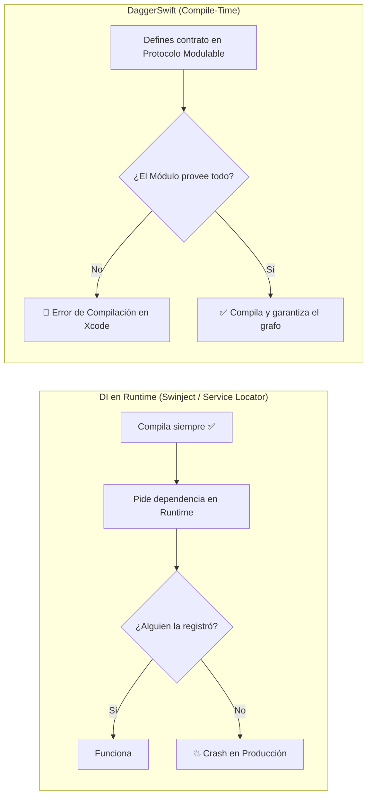
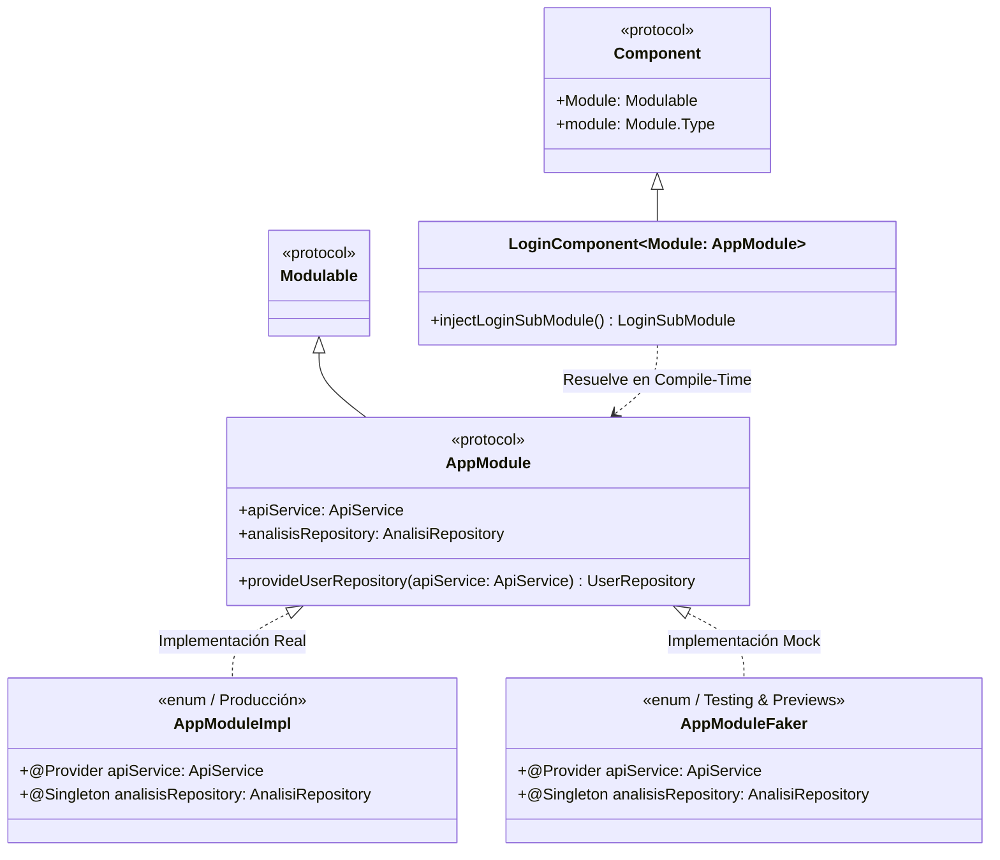
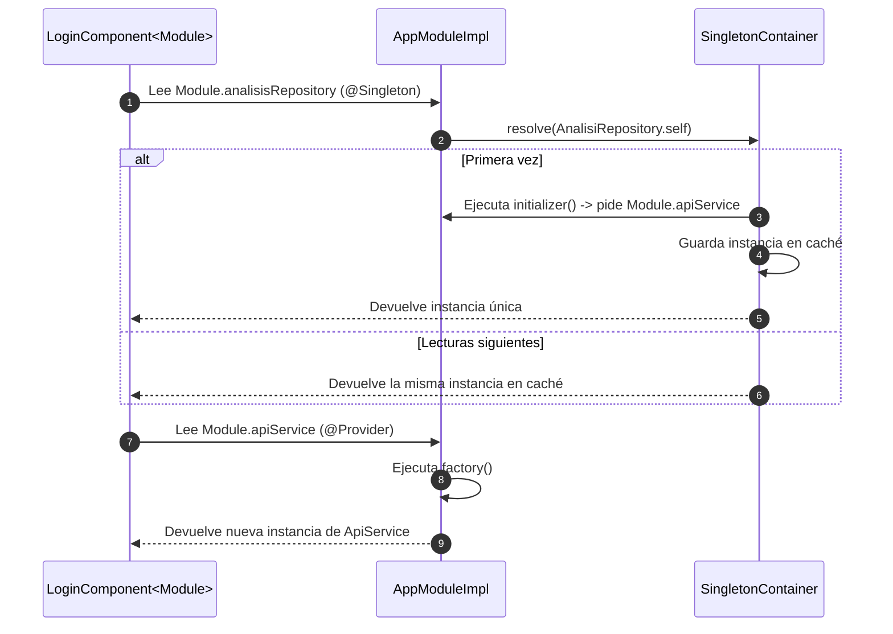
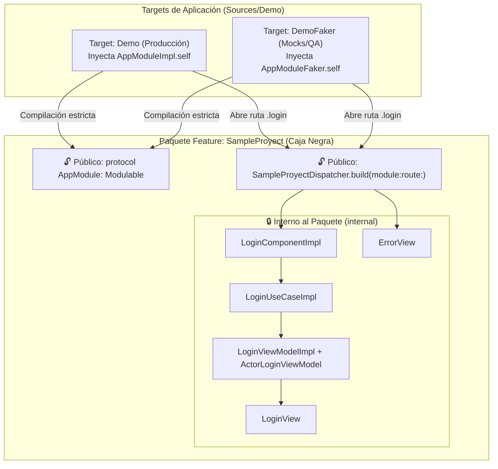

# dagger-swift (v1)

Inyección de dependencias para Swift resueltas en **compile-time**, no en runtime.

Inspirado en [Dagger (Android)](https://dagger.dev): defines un módulo, declaras qué provee, y el compilador garantiza que todo conecta. Sin reflexión. Sin contenedores dinámicos sueltos. Sin *service locators*.

---

## Por qué

La mayoría de las soluciones DI en Swift (*Swinject*, *Resolver*, *Factory*) resuelven dependencias **en runtime**: registras closures en un contenedor global y esperas que el tipo correcto esté registrado cuando alguien lo pida. Si alguien olvidó registrarlo, la app compila sin errores y **explota en producción**.

`DaggerSwift` toma el enfoque opuesto: **si compila, las dependencias están resueltas.**



---

## Arquitectura General

`DaggerSwift` se basa en **4 piezas fundamentales**:

1. **`Modulable`**: Protocolo que define el contrato estático de dependencias que un módulo necesita o provee.
2. **`Component`**: Ensamblador tipado (`Component<Module: Modulable>`) que conecta las dependencias del módulo con los casos de uso, ViewModels y vistas internas.
3. **`@Singleton` y `@Provider`**: Property wrappers que declaran explícitamente el ciclo de vida de cada dependencia dentro del módulo.
4. **`Dispatcher` (Frontera del Módulo)**: Puerta de entrada pública de un paquete/feature que mantiene ocultas (`internal`) todas sus capas internas.



---

## Cómo funciona paso a paso

### 1. Módulo (`Modulable`) — Define qué se provee y su ciclo de vida

El protocolo declara **qué piezas existen** y la implementación define **cómo se construyen** usando `@Singleton` o `@Provider`:

```swift
import DaggerSwift

protocol AppModule: Modulable {
    static var apiService: ApiService { get }
    static var analisisRepository: AnalisiRepository { get }
    static func provideUserRepository(apiService: ApiService) -> UserRepository
}

enum AppModuleImpl: AppModule {
    // Nueva instancia en cada lectura
    @Provider(wrappedValue: .init())
    static var apiService: ApiService

    // Única instancia compartida (Lazy)
    @Singleton(wrappedValue: .init(apiService: apiService))
    static var analisisRepository: AnalisiRepository

    static func provideUserRepository(apiService: ApiService) -> UserRepository {
        .init(apiService: apiService)
    }
}
```

### 2. Component (`Component`) — Conecta el módulo con la Feature

El `Component` está parametrizado con el genérico `<Module: AppModule>`. No conoce implementaciones concretas (`AppModuleImpl` ni `AppModuleFaker`), solo el contrato:

```swift
protocol AppComponent: Component {}

struct LoginComponent<Module: AppModule>: AppComponent {
    static func injectLoginSubModule() -> LoginSubModule {
        .init(
            analisiRepository: Module.analisisRepository,
            userRepository: Module.provideUserRepository(apiService: Module.apiService)
        )
    }
}
```

### 3. Ciclo de Vida: `@Singleton` vs `@Provider`

| Property Wrapper | Comportamiento | Cuándo se instancia |
| :--- | :--- | :--- |
| **`@Singleton`** | Devuelve **siempre la misma instancia** almacenada en `SingletonContainer`. | *Lazy*: la primera vez que alguien accede a la propiedad. |
| **`@Provider`** | Crea y devuelve una **nueva instancia** cada vez que se lee la propiedad. | En cada acceso al getter de la propiedad. |



---

## Arquitectura Modular ("Caja Negra") — `SampleProyect`, `Demo` y `DemoFaker`

El repositorio incluye un ejemplo completo de cómo estructurar **módulos aislados por Feature** en [`Sources/SampleProyect`](./Sources/SampleProyect) y cómo consumirlos desde dos targets de aplicación en [`Sources/Demo`](./Sources/Demo):



1. **Encapsulamiento real**: Dentro de `SampleProyect`, `LoginView`, `LoginViewModelImpl`, `LoginUseCaseImpl` y `LoginComponentImpl` son `internal`. Ningún otro módulo puede instanciarlos directamente ni saltarse la arquitectura.
2. **Intercambio de entorno en 1 línea**:
   - En **Producción (`Demo`)**: `SampleProyectDispatcher.build(module: AppModuleImpl.self, route: .login)`
   - En **Faker (`DemoFaker`)**: `SampleProyectDispatcher.build(module: AppModuleFaker.self, route: .login)`
   - Si agregas una dependencia nueva a `AppModule` en `SampleProyect`, **tanto `Demo` como `DemoFaker` te obligan en tiempo de compilación a proveerla**.

---

## Estructura del Repositorio

```text
├── Package.swift                 # Configuración SPM (Swift 6.0)
├── Sources/
│   ├── DaggerSwift/
│   │   └── Module.swift          # Núcleo: Modulable, Component, @Singleton, @Provider
│   ├── SampleProyect/            # Paquete SPM independiente (Feature Caja Negra)
│   │   └── Sources/SampleProyect/
│   │       ├── Core/             # Contrato público AppModule y SampleProyectDispatcher
│   │       ├── Data/             # Contratos e implementaciones de datos (ApiClient, Analytics, Repos)
│   │       ├── Doman/            # Casos de uso (LoginUseCase)
│   │       └── Presentation/     # LoginComponent, LoginView, LoginViewModel, ErrorView
│   └── Demo/                     # Proyecto Xcode con 2 targets: Demo (Real) y DemoFaker (Mocks)
├── Test/
│   └── ModuleTest.swift          # Suite de pruebas unitarias de DaggerSwift
├── MEMORIA_DAGGER_V1.md          # Análisis crítico, limitaciones de v1 y diseño hacia v2
└── MANIFESTO.md                  # Filosofía de código abierto del proyecto
```

---

## Instalación y Uso

```swift
// Package.swift
dependencies: [
    .package(url: "https://github.com/fsaldivar-dev/dagger-swift.git", from: "1.0.0")
]
```

Para ejecutar las pruebas del paquete desde terminal:

```bash
swift test
```

## Plataformas

macOS 10.15+ | iOS 13+ | tvOS 13+ | watchOS 6+ | Mac Catalyst 13+ | **Swift 6.0+**

---

## Memoria Técnica y Evolución hacia DaggerSwift v2

El análisis detallado de las limitaciones encontradas al llevar **DaggerSwift v1** a aplicaciones productivas con **SwiftUI** (infección de genéricos, pérdida de identidad con `AnyView`, recreación de `@ObservedObject`, falta de Scopes por módulo/sesión y resolución de Feature Flags / Precondiciones en Deep Links) está documentado en:

👉 **[Memoria Técnica: Limitaciones de DaggerSwift v1 y Camino a v2](./MEMORIA_DAGGER_V1.md)**

---

## Licencia

MIT

---

> *El conocimiento se pudre cuando se guarda. Se mantiene vivo cuando se comparte.* — [Manifiesto](./MANIFESTO.md)
