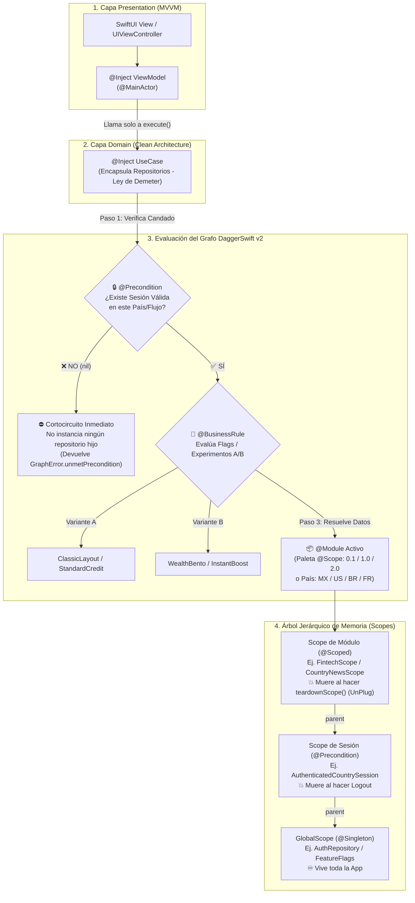
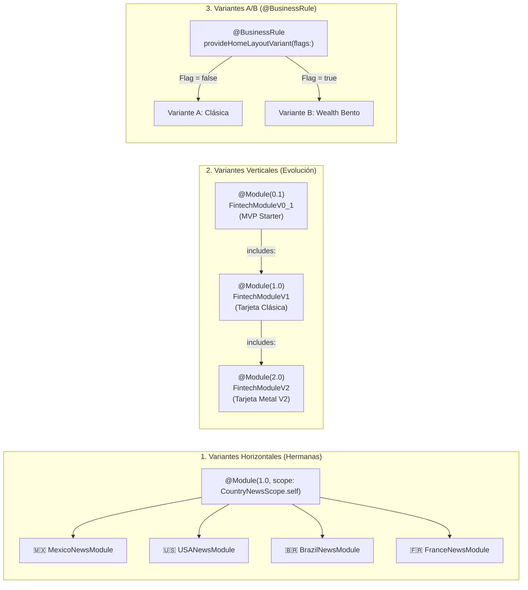

# DaggerSwift v2 (`dagger-swift`)


Motor híbrido de **Resolución Explícita en Tiempo de Compilación (`@Module`, `@Scope`, `@Inject`)** y **Grafo Jerárquico de Dependencias (`@BusinessRule`, `@Precondition`, `teardownScope()`)** para Swift 6, SwiftUI, UIKit y Actores de Concurrencia.

> 📘 **[Leer el Libro Completo: Resolución Explícita vs. Dinámica, Comparativa contra Otras Librerías y Benchmarks](./LIBRO_INYECCION_Y_BENCHMARKS.md)**

---

## 📑 Tabla de Contenidos (Manual Completo)

1. **[Cómo Funciona el Grafo de Dependencias (Diagrama General)](#1--cómo-funciona-el-grafo-de-dependencias-diagrama-general)**
2. **[Manual de Conceptos y Decoradores](#2--manual-de-conceptos-y-decoradores)**
   - [2.1 ¿Qué es un `@Module`?](#21-qué-es-un-module)
   - [2.2 ¿Qué es una Variante y cómo se modela? (3 Tipos de Variantes)](#22-qué-es-una-variante-y-cómo-se-modela-3-tipos-de-variantes)
   - [2.3 ¿Cómo funciona `@Inject` y `@Inject(scope:)` por dentro?](#23-cómo-funciona-inject-y-injectscope-por-dentro)
   - [2.4 ¿Qué es una `@Precondition` (Candado de Estado / Sesión por País)?](#24-qué-es-una-precondition-candado-de-estado--sesión-por-país)
   - [2.5 Ciclo de Vida, Memoria y `Plug & UnPlug` (`teardownScope()`)](#25-ciclo-de-vida-memoria-y-plug--unplug-teardownscope)
3. **[Manual Completo de Pruebas (`DaggerSwiftTesting` + Unit Tests + Linter)](#3--manual-completo-de-pruebas-daggerswifttesting--unit-tests--linter)**
   - [3.1 Nivel 1: Pruebas Unitarias Puras (Sin Grafo)](#31-nivel-1-pruebas-unitarias-puras-sin-grafo)
   - [3.2 Nivel 2: Pruebas del Grafo de Dependencias (`expectGraph` DSL)](#32-nivel-2-pruebas-del-grafo-de-dependencias-expectgraph-dsl)
   - [3.3 Nivel 3: Linter Automático de Arquitectura y SOLID](#33-nivel-3-linter-automático-de-arquitectura-y-solid)
4. **[Benchmarks y Comparativa contra Otras Librerías](#4--benchmarks-y-comparativa-contra-otras-librerías)**
5. **[Demos Reales Incluidas (`SampleProyect`) y Estructura del Repositorio](#5--demos-reales-incluidas-sampleproyect-y-estructura-del-repositorio)**

---

## 1. 🧠 Cómo Funciona el Grafo de Dependencias (Diagrama General)

A diferencia de un *Service Locator* tradicional (donde todo vive revuelto en un diccionario global), **DaggerSwift v2** organiza tus dependencias como un **Grafo Acíclico Dirigido (DAG)** dividido en **3 tipos de nodos** (*Precondición*, *Regla de Negocio* y *Dominio*) y **3 niveles de ciclo de vida en memoria (Scopes)**:



### ¿Qué ocurre paso a paso cuando pides un componente?
1. **Verificación de `@Precondition` (Cortocircuito):** Si el `UseCase` o `ViewModel` requiere una precondición (como `AuthenticatedCountrySession` o `ValidatedSession`), el grafo evalúa primero esa función. Si devuelve `nil`, **detiene inmediatamente la construcción** sin instanciar un solo objeto del sub-árbol.
2. **Evaluación de `@BusinessRule` (Variantes A/B en caliente):** Si el componente depende de una regla de negocio o experimento A/B, evalúa el estado actual de los flags y entrega la variante correspondiente.
3. **Resolución por Scope (`@Scoped` / `@Singleton` / `@Provider`):**
   - Si es `@Provider`, crea una instancia nueva.
   - Si es `@Scoped`, busca la instancia en la caja del módulo activo (y la registra en `WeakObjectBox` para auditar que no existan *retain cycles* cuando el módulo se cierre).
   - Si es `@Singleton`, sube hasta el `GlobalScope` raíz y reutiliza la instancia única.

---

## 2. 🛠 Manual de Conceptos y Decoradores

### 2.1 ¿Qué es un `@Module`?

Un **`@Module`** es una pieza declarativa (conectada en la capa `Data / DI`) que le enseña al grafo **cómo construir las implementaciones concretas** de los protocolos de tu Dominio.

Al anotar un `enum` o `struct` con `@Module`, el Compiler Plugin de DaggerSwift:
- Hace que conforme automáticamente `GraphModule`, `GraphScope` y `Modulable`.
- Registra todas sus funciones estáticas según su decorador de ciclo de vida:

| Decorador dentro de `@Module` | Ciclo de Vida | Cuándo se instancia | Cuándo muere en RAM |
| :--- | :--- | :--- | :--- |
| **`@Singleton`** | `GlobalScope` | *Lazy* (la primera vez que alguien lo pide) | Al cerrar la aplicación. |
| **`@Scoped`** | Scope del `@Module` (o el indicado en `@Module(scope:)`) | *Lazy* al entrar al módulo/flujo | Al llamar a `Module.teardownScope()` o salir de `GraphScopeView`. |
| **`@Scoped(OtroScope.self)`** | Scope explícito (ej. `ValidatedSession.self`) | *Lazy* mientras ese Scope esté activo | Cuando `OtroScope` ejecuta `teardown()`. |
| **`@Provider`** | Transitorio (*Transient*) | Crea una instancia **nueva** en cada resolución | En cuanto el consumidor suelta la referencia ARC. |
| **`@BusinessRule`** | Dinámico por evaluación | Se re-evalúa al consultar la regla/flag | No se cachea; entrega la variante activa al momento. |
| **`@Precondition("Razón")`** | Candado de Sub-Grafo | Se evalúa **antes** que cualquier nodo que dependa de ella | Si devuelve `nil`, aborta la resolución con `unmetPrecondition`. |

#### Ejemplo de un `@Module` completo:

```swift
import DaggerSwift

@Module(1.0, scope: CountryNewsScope.self)
public enum MexicoNewsModule: CountryNewsModuleContract {
    // 1. Candado de seguridad: exige sesión activa específicamente en México
    @Precondition("Se requiere sesión activa en México (🇲🇽)")
    public static func validateSession(
        auth: any CountryAuthRepositoryProtocol
    ) -> AuthenticatedCountrySession? {
        auth.session(for: .mexico)
    }

    // 2. Dependencias atadas a la vida del módulo (mueren al cambiar de país)
    @Scoped
    public static func localeProvider() -> any CountryLocaleProviderProtocol {
        MexicoLocaleProvider()
    }

    @Scoped
    public static func newsRepository() -> any CountryNewsRepositoryProtocol {
        MexicoNewsRepository() // Swift 6 native `actor`
    }
}
```

---

### 2.2 ¿Qué es una Variante y cómo se modela? (3 Tipos de Variantes)

En productos reales existen **3 tipos de variantes** y `DaggerSwift v2` tiene soporte nativo para las tres:



#### Tipo A: Variantes Horizontales (Variantes Hermanas / Multi-Country)
Cuando tienes el mismo producto operando en distintos países (**🇲🇽 México**, **🇺🇸 USA**, **🇧🇷 Brasil**, **🇫🇷 Francia**):
1. Creas un `GraphScope` y un contrato compartido en `Domain`:
   ```swift
   public enum CountryNewsScope: GraphScope {}

   public protocol CountryNewsModuleContract: GraphModule {
       static func validateSession(auth: any CountryAuthRepositoryProtocol) -> AuthenticatedCountrySession?
       static func localeProvider() -> any CountryLocaleProviderProtocol
       static func newsRepository() -> any CountryNewsRepositoryProtocol
   }
   ```
2. Cada país implementa su propio `@Module(1.0, scope: CountryNewsScope.self)` conformando `CountryNewsModuleContract`.
3. Tus `UseCases` y `ViewModels` solo se atan a `@Inject(scope: CountryNewsScope.self)` — **jamás conocen a `MexicoNewsModule` ni a `FranceNewsModule`**.

#### Tipo B: Variantes Verticales (Evolución de Producto `0.1 -> 1.0 -> 2.0` con `@Scope`)
Cuando un producto evoluciona de un MVP (`0.1`) a `1.0` y luego a `2.0`:
1. Usas `includes: [VersionAnterior.self]` para **heredar** todos los servicios que no cambiaron (por ejemplo, el Core Bancario) y **sobrescribir únicamente** lo que evolucionó (por ejemplo, el motor de tarjetas):
   ```swift
   @Module(0.1, scope: FintechScope.self)
   public enum FintechModuleV0_1: FintechModuleContract {
       @Scoped public static func coreBanking() -> any FintechCoreBankingProtocol { FintechCoreBankingImpl() }
       @Scoped public static func cardEngine() -> any FintechCardEngineProtocol { FintechCardEngineV0_1() }
   }

   @Module(1.0, scope: FintechScope.self, includes: [FintechModuleV0_1.self])
   public enum FintechModuleV1: FintechModuleContract {
       @Scoped public static func cardEngine() -> any FintechCardEngineProtocol { FintechCardEngineV1() }
       public static func coreBanking() -> any FintechCoreBankingProtocol { FintechModuleV0_1.coreBanking() }
   }

   @Module(2.0, scope: FintechScope.self, includes: [FintechModuleV1.self])
   public enum FintechModuleV2: FintechModuleContract {
       @Scoped public static func cardEngine() -> any FintechCardEngineProtocol { FintechCardEngineV2() }
       public static func coreBanking() -> any FintechCoreBankingProtocol { FintechModuleV1.coreBanking() }
   }
   ```
2. Usas el macro **`@Scope`** (integrado en la librería al estilo `CodingKeys`) para que `DaggerSwift` sintetice automáticamente el enumerador `Palette` (`ModulePalette`: `.v0_1`, `.v1_0`, `.v2_0`) y el selector estático en tiempo de compilación:
   ```swift
   @Scope(
       of: (any FintechModuleContract).self,
       v0_1: FintechModuleV0_1.self,
       v1_0: FintechModuleV1.self,
       v2_0: FintechModuleV2.self
   )
   extension FintechScope {}

   // Uso en cualquier parte sin escribir switches manuales:
   let activeModule = FintechScope.module(for: .v2_0) // Devuelve FintechModuleV2.self
   ```

#### Tipo C: Variantes Dinámicas / Experimentos A/B (`@BusinessRule`)
Cuando dentro de una misma versión quieres conmutar en vivo entre dos diseños o algoritmos mediante Feature Flags:
```swift
@Module(1.0)
public enum FintechCoreModule {
    @BusinessRule
    public static func provideHomeLayoutVariant(
        flags: any FintechABFlagsRepositoryProtocol
    ) -> any FintechHomeLayoutVariantProtocol {
        flags.isWealthBentoVariantB ? WealthBentoLayoutVariant() : ClassicBalanceLayoutVariant()
    }
}
```

---

### 2.3 ¿Cómo funciona `@Inject` y `@Inject(scope:)` por dentro?

En otras librerías tienes que ensuciar tus propiedades con `@Injected var repo: Repo` (lo cual mete un *Service Locator* oculto dentro de tu clase) o escribir inicializadores boilerplate interminables.

En **DaggerSwift v2**, colocas `@Inject` arriba de tu `struct` o `class`:

```swift
// Lo único que tú escribes en Domain:
@Inject
public struct GetProfileUseCase: Sendable {
    let gitHubRepository: any GitHubRepositoryProtocol

    public func execute(username: String = "fsaldivar-dev") async throws -> GitHubUserProfile {
        try await gitHubRepository.fetchProfile(username: username)
    }
}
```

#### ¿Qué expande automáticamente el macro `@Inject` en tiempo de compilación?

```swift
// Generado automáticamente por DaggerSwiftMacrosPlugin:
extension GetProfileUseCase: DaggerSwift.Injectable {
    // 1. Inicializador explícito 100% puro (para resolución en compile-time y Unit Tests sin grafo):
    public init(gitHubRepository: any GitHubRepositoryProtocol) {
        self.gitHubRepository = gitHubRepository
    }

    // 2. Inicializador desde el contenedor DAG:
    public init(from container: DaggerSwift.ScopeContainer) throws {
        self.init(gitHubRepository: try container.resolve((any GitHubRepositoryProtocol).self))
    }

    // 3. Auto-registro Just-In-Time (no necesitas registrarlo manualmente en ningún @Module):
    nonisolated public static func register(in container: DaggerSwift.ScopeContainer) {
        container.provide(Self.self) { (gitHubRepository: any GitHubRepositoryProtocol) in
            Self(gitHubRepository: gitHubRepository)
        }
    }
}
```

> **💡 Regla inteligente con `@Published` y `@State`:** Si aplicas `@MainActor @Inject` a un `ViewModel` de SwiftUI, el macro detecta automáticamente qué propiedades son dependencias (`let useCase: MyUseCase`) y **excluye** del `init` las propiedades `@Published`, `@State` o con valor por defecto (`= []`).

---

### 2.4 ¿Qué es una `@Precondition` (Candado de Estado / Sesión por País)?

Una **`@Precondition`** es un tipo que conforma el protocolo `Precondition` (por ejemplo, `AuthenticatedCountrySession` o `ValidatedSession`) y representa un **requisito obligatorio de estado** para que un sub-grafo pueda existir.

1. Declaras el modelo de tu precondición en `Domain`:
   ```swift
   public struct AuthenticatedCountrySession: Precondition, Sendable, Equatable {
       public let country: SupportedCountry
       public let userIdentifier: String
       public let sessionToken: String
   }
   ```
2. Tu `UseCase` la pide como parámetro en su estructura `@Inject`:
   ```swift
   @Inject(scope: CountryNewsScope.self)
   public struct GetLocalizedNewsFeedUseCase: Sendable {
       public let session: AuthenticatedCountrySession // <- Exige la @Precondition
       let localeProvider: any CountryLocaleProviderProtocol
       let newsRepository: any CountryNewsRepositoryProtocol
   }
   ```
3. Tu `@Module` declara cómo validar esa precondición con `@Precondition("...")` devolviendo un opcional (`AuthenticatedCountrySession?`):
   - Si devuelve `nil` (por ejemplo, el usuario inició sesión en **🇲🇽 México** pero intenta abrir las noticias de **🇺🇸 USA**), **el grafo bloquea el acceso** antes de tocar `USANewsRepository`.

---

### 2.5 Ciclo de Vida, Memoria y `Plug & UnPlug` (`teardownScope()`)

Cuando cambias de un módulo a otro en caliente (por ejemplo, de `MexicoNewsModule` a `FranceNewsModule`, o de `FintechModuleV1` a `FintechModuleV2`), aplicas el patrón **Plug & UnPlug**:

```swift
public func selectPalette(_ option: FintechScope.Palette) {
    // 1. UNPLUG: Desconecta el módulo anterior y libera todas sus instancias @Scoped de RAM
    let previousModule = FintechScope.module(for: selectedPalette)
    let leakedClasses = previousModule.teardownScope()
    assert(leakedClasses.isEmpty, "Se detectó un retain cycle en: \(leakedClasses)")

    // 2. PLUG: Conecta el nuevo módulo de la paleta (0.1, 1.0 o 2.0)
    selectedPalette = option
    Task { await reloadFromActiveModule() }
}
```

Si una clase `@Scoped` necesita cancelar un `Task`, cerrar un WebSocket o limpiar un `Timer` cuando su módulo se desconecta, simplemente conforma **`ScopeDisposable`**:

```swift
@Inject(scope: RepoDetailModule.self)
public final class RepoDetailInspector: ScopeDisposable, Sendable {
    public let session: ValidatedSession

    public func onScopeTeardown() {
        // Se ejecuta automáticamente en el instante en que se llama a RepoDetailModule.teardownScope()
    }
}
```

---

## 3. 🧪 Manual Completo de Pruebas (`DaggerSwiftTesting` + Unit Tests + Linter)

DaggerSwift v2 está diseñado para probar tu aplicación en **3 niveles complementarios**:

### 3.1 Nivel 1: Pruebas Unitarias Puras (Sin Grafo)

Gracias a que `@Inject` genera un `public init(...)` estándar y limpio, tus pruebas unitarias en [`AppUnitTests.swift`](./Sources/SampleProyect/Tests/AppUnitTests/AppUnitTests.swift) **no necesitan inicializar ningún contenedor de DI**:

```swift
import Testing
import Core

@Test("GetProfileUseCase obtiene el perfil de @fsaldivar-dev")
func testObtenerPerfil() async throws {
    // 1. Instancias tu UseCase directamente pasando un Fake por constructor:
    let useCase = GetProfileUseCase(gitHubRepository: FakerGitHubRepository())
    let profile = try await useCase.execute()

    #expect(profile.login == "fsaldivar-dev")
}

@Test("FeedViewModel filtra repositorios conectando un FakeModule con Plug & UnPlug")
@MainActor
func testFeedViewModelConFakeModule() async {
    // 2. O conectas un @Module Fake completo en 1 línea:
    let viewModel = FeedViewModel.plug(FakerGitHubModule.self)
    await viewModel.loadInitialData()
    viewModel.searchText = "AutoPilot"

    #expect(viewModel.filteredRepositories.count == 1)
}
```

---

### 3.2 Nivel 2: Pruebas del Grafo de Dependencias (`expectGraph` DSL)

El target **`DaggerSwiftTesting`** incluye un DSL declarativo ([`AppGraphTests.swift`](./Sources/SampleProyect/Tests/AppGraphTests/AppGraphTests.swift)) para auditar tu grafo de dependencias completo en milisegundos sin levantar simuladores ni vistas:

#### A. Validar que un grafo resuelve todos sus componentes y cumple el contrato de otro módulo
```swift
import Testing
import DaggerSwiftTesting

@Test("El módulo V2 y el módulo Fake cumplen exactamente el contrato de V1")
func testContratoYResolucion() {
    expectGraph(ShowcaseCoreModule.self, FakerGitHubModule.self)
        .matchesContract(of: LiveGitHubModule.self) // Verifica que provea exactamente los mismos tipos
        .resolved((any GitHubRepositoryProtocol).self)
        .resolved(GetProfileUseCase.self)
        .resolved(FeedViewModel.self)
}
```

#### B. Reemplazar una dependencia al vuelo con un Fake (`whenResolved(...).returns(...)`)
```swift
@Test("Inyectar un Fake al vuelo sobre el grafo de producción")
func testOverrideAlVuelo() {
    expectGraph(ShowcaseCoreModule.self, LiveGitHubModule.self)
        .whenResolved((any GitHubRepositoryProtocol).self).returns(FakerGitHubRepository.self)
        .resolved(FeedViewModel.self)
}
```

#### C. Probar candados `@Precondition` y aislamiento por País (`.preconditionFailure()` + `.when`)
```swift
@Test("Iniciar sesión en México desbloquea México, pero USA sigue bloqueado por @Precondition")
func testAislamientoPorPais() {
    // 1. Si el usuario se loguea en México, intentar resolver USA falla con preconditionFailure()
    expectGraph(CountryAuthServiceModule.self, USANewsModule.self)
        .when { (auth: any CountryAuthRepositoryProtocol) in
            auth.login(identifier: "+52 55 8421 0900", country: .mexico)
        }
        .dependency(GetLocalizedNewsFeedUseCase.self).preconditionFailure()
        // 2. Al autenticarse en USA, la precondición de USANewsModule se libera:
        .when { (auth: any CountryAuthRepositoryProtocol) in
            auth.login(identifier: "+1 415 890 4210", country: .usa)
        }
        .dependency(GetLocalizedNewsFeedUseCase.self).resolved {
            $0.copy.languageCode == "en-US"
        }
}
```

#### D. Probar el cambio dinámico de `@BusinessRule` (Experimentos A/B)
```swift
@Test("Conmutar flags A/B en vivo actualiza las variantes entregadas por el grafo")
func testBusinessRulesAB() {
    expectGraph(FintechCoreModule.self, FintechSharedFlagsModule.self, FintechModuleV2.self)
        .dependency(GetFintechDashboardUseCase.self).resolved {
            $0.cardProduct.moduleVersionTag.contains("Module(2.0)") &&
            $0.layoutVariant.variantCode == "B" &&
            $0.creditOfferVariant.experimentCode == "Exp-B"
        }
        .when { (flags: any FintechABFlagsRepositoryProtocol) in
            flags.setWealthBentoVariantB(false)
            flags.setInstantCreditBoostVariantB(false)
        }
        .dependency(GetFintechDashboardUseCase.self).resolved {
            $0.layoutVariant.variantCode == "A" &&
            $0.creditOfferVariant.experimentCode == "Control-A"
        }
}
```

#### E. Detectar dependencias faltantes (`.unresolvedFailure()`)
```swift
@Test("Si falta el módulo de servicios, el grafo reporta unresolvedFailure()")
func testModuloFaltante() {
    expectGraph(ShowcaseCoreModule.self)
        .dependency(GetProfileUseCase.self).unresolvedFailure()
}
```

---

### 3.3 Nivel 3: Linter Automático de Arquitectura y SOLID

En [`ArchitectureLinterTests.swift`](./Sources/SampleProyect/Tests/AppGraphTests/ArchitectureLinterTests.swift) incluimos un **Linter de Arquitectura en Swift** que escanea todo el código fuente de `SampleProyect` en cada `swift test` y falla si alguien rompe cualquiera de estas **7 reglas**:

1. **`[RULE-01]` División por Capas:** Exige las carpetas `Domain/Entities`, `Domain/Repositories`, `Domain/UseCases`, `Data/Repositories`, `Data/DI`, `Presentation/View`, `Presentation/ViewModel` y prohíbe `*Composer.swift` manuales.
2. **`[RULE-02]` Pureza de `Domain`:** Prohíbe `import SwiftUI` o referencias a `*Impl`, `*Actor` o `Live*` dentro de `Domain/`.
3. **`[RULE-03]` SOLID en `UseCases` + Ley de Demeter:** Exige `@Inject`, `func execute(...)` y prohíbe exponer los repositorios como `public let`.
4. **`[RULE-04]` UnCoupling en `Presentation`:** Prohíbe que `View` o `ViewModel` instancien tipos de `Data` o atraviesen un `UseCase` para llamar a un repositorio.
5. **`[RULE-05]` Plug & UnPlug:** Exige `@Module` en `DI/` y `teardownScope()` en cada `ViewModel`.
6. **`[RULE-06]` Seguridad & Swift 6 Concurrency:** Prohíbe `try!`, `try?`, `ScopeContainer`, `NSLock` y `@unchecked Sendable` en la app.
7. **`[RULE-07]` Simplicidad de Lectura:** Ningún archivo de ejemplo supera las **180 líneas**.

---

## 4. 📊 Benchmarks y Comparativa contra Otras Librerías

Resultados reales ejecutando [`Test/BenchmarkComparisonTests.swift`](./Test/BenchmarkComparisonTests.swift) (**10,000 resoluciones** en Apple Silicon `arm64e-apple-macos`):

| Escenario / Librería | Tiempo (10,000 iter.) | Latencia / Resolución | Seguridad en Compilación | Cortocircuito `@Precondition` | Auditoría Leaks (`WeakObjectBox`) |
| :--- | :---: | :---: | :---: | :---: | :---: |
| **1. DaggerSwift Modo Explícito (`@Module` + `@Scope` + `@Inject`)** | **`1.74 ms`** | **`~174 ns`** | **✅ 100% Compile-Time** | **✅ Sí** | **✅ Sí** |
| **2. Service Locator Dinámico (Swinject / Resolver style)** | `13.62 ms` | `~1.36 µs` | ❌ Falla en Runtime (`nil` / `try!`) | ❌ No existe | ❌ No existe |
| **3. DaggerSwift Motor DAG (`ScopeContainer` + CycleCheck)** | `23.05 ms` | `~2.30 µs` | ✅ Verificado con `expectGraph` | **✅ Sí (`3.82 µs` bloqueo en frío)** | **✅ Sí (`teardown() -> [String]`)** |

👉 **Lee el análisis profundo de los 5 huecos de otras librerías, puntos fuertes y puntos débiles en [`LIBRO_INYECCION_Y_BENCHMARKS.md`](./LIBRO_INYECCION_Y_BENCHMARKS.md).**

---

## 5. 📱 Demos Reales Incluidas (`SampleProyect`) y Estructura del Repositorio

```text
├── Package.swift                        # Configuración SPM (Swift 6.0, macOS 14+ / iOS 17+, CLI + Macros + Testing)
├── Assets/
│   └── dagger2-hero.png                 # Portada oficial de DaggerSwift v2
├── LIBRO_INYECCION_Y_BENCHMARKS.md      # Libro Técnico: Resolución Explícita vs Dinámica y Benchmarks
├── Sources/
│   ├── DaggerSwift/
│   │   ├── GraphScope.swift             # ScopeID, GraphScope, GlobalScope, Precondition, ScopeDisposable, GraphError
│   │   ├── ScopeContainer.swift         # Motor DAG, Árbol de Scopes, Parameter Packs y Auditoría WeakObjectBox
│   │   ├── SwiftUIGraph.swift           # GraphScopeView y ciclo de vida automático en SwiftUI
│   │   └── Module.swift                 # Macros: @Module(0.1/1.0/2.0), @Scope (ModulePalette), @Inject, @Singleton, @Scoped, @Provider, @BusinessRule, @Precondition
│   ├── DaggerSwiftMacros/               # Compiler Plugin nativo Swift 6 (protocolo JSON HostToPluginMessage, <0.3s build)
│   ├── DaggerSwiftTesting/              # DSL declarativo para pruebas del grafo (expectGraph, matchesContract, when)
│   ├── DaggerCLI/                       # Herramienta de terminal (swift run dagger-cli)
│   ├── SampleProyect/                   # Paquete SPM Modular con 3 Demos (Clean Architecture + MVVM + SOLID + Plug & UnPlug):
│   │   ├── Sources/
│   │   │   ├── AppFoundation/           # Modelos base y Design System compartido
│   │   │   ├── MultiCountryNewsDemo/    # Demo 1: Login Multi-Country + Noticias en 4 Idiomas (MX, US, BR, FR)
│   │   │   │   ├── Domain/              # Entities, Repository Protocols (CountryNewsModuleContract) y UseCases (@Inject)
│   │   │   │   ├── Data/                # Actores Swift 6 por país y @Module(1.0, scope: CountryNewsScope.self) con @Precondition por país
│   │   │   │   └── Presentation/        # MVVM: CountryNewsPortalViewModel (@Inject) + CountryNewsFeatureView
│   │   │   ├── FintechMockupDemo/       # Demo 2: App Mockup Fintech con Paleta @Module(0.1/1.0/2.0) + @Scope + A/B Flags
│   │   │   │   ├── Domain/              # Entities, Repository Protocols (FintechModuleContract) y GetFintechDashboardUseCase
│   │   │   │   ├── Data/                # FintechBankingActor y @Module(0.1), @Module(1.0), @Module(2.0) + @Scope
│   │   │   │   └── Presentation/        # MVVM: FintechMockupViewModel (@Inject) + FintechMockupFeatureView
│   │   │   ├── Core/                    # Demo 3 (Domain): Protocolos, @Precondition ValidatedSession y UseCases (@Inject)
│   │   │   ├── Services/                # Demo 3 (Data): LiveGitHubRepository + LiveGitHubModule (1.0) / LiveGitHubModuleV2 (2.0)
│   │   │   ├── Features/                # Demo 3 (Presentation): FeedViewModel (@Inject), FeedView y Sub-Scope RepoDetailModule
│   │   │   └── SampleProyect/           # ShowcaseRootView: Selector de las 3 Demos y switch Plug & UnPlug en vivo
│   │   └── Tests/
│   │       ├── AppUnitTests/            # Pruebas unitarias de UseCases y ViewModels con Fakes sin grafo
│   │       └── AppGraphTests/           # Pruebas del grafo (DaggerSwiftTesting) + ArchitectureLinterTests (Linter SOLID/Clean)
│   └── Demo/                            # Proyecto Xcode iOS / iPadOS / macOS (Targets Demo y DemoFaker)
└── Test/
    ├── ModuleTest.swift                 # Pruebas de retrocompatibilidad DaggerSwift v1
    ├── DaggerMacrosV2Tests.swift        # Pruebas de expansión de macros @Module y @Inject
    ├── GraphEngineV2Tests.swift         # Pruebas de motor DAG, Scopes, Preconditions y Retain Cycles
    └── BenchmarkComparisonTests.swift   # Benchmarks de 10,000 iteraciones y validación de huecos vs otras librerías
```

---

## 🚀 Comandos Rápidos

```bash
# 1. Ejecutar tests del motor principal DaggerSwift + Benchmarks comparativos (20 tests)
swift test

# 2. Ejecutar Linter de Arquitectura/SOLID + Unit Tests + Graph Tests del SampleProyect (12 tests)
swift test --package-path Sources/SampleProyect

# 3. Ejecutar el CLI interactivo de DaggerSwift
swift run dagger-cli help
```

---

## 📚 Documentación Adicional

- 📘 **[El Libro de DaggerSwift v2: Resolución Explícita vs. Dinámica, Comparativa y Benchmarks](./LIBRO_INYECCION_Y_BENCHMARKS.md)**
- 📄 **[Memoria Técnica: Limitaciones de DaggerSwift v1 y Dolores en Apps Productivas](./MEMORIA_DAGGER_V1.md)**
- 📜 **[Manifiesto](./MANIFESTO.md)**

## Licencia

MIT
